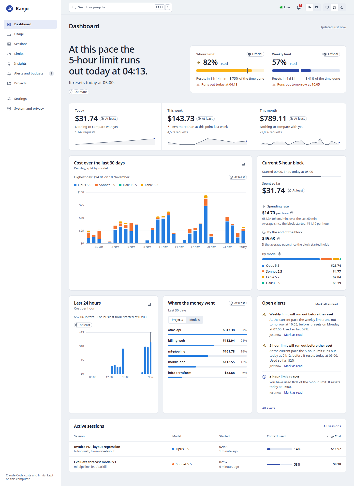
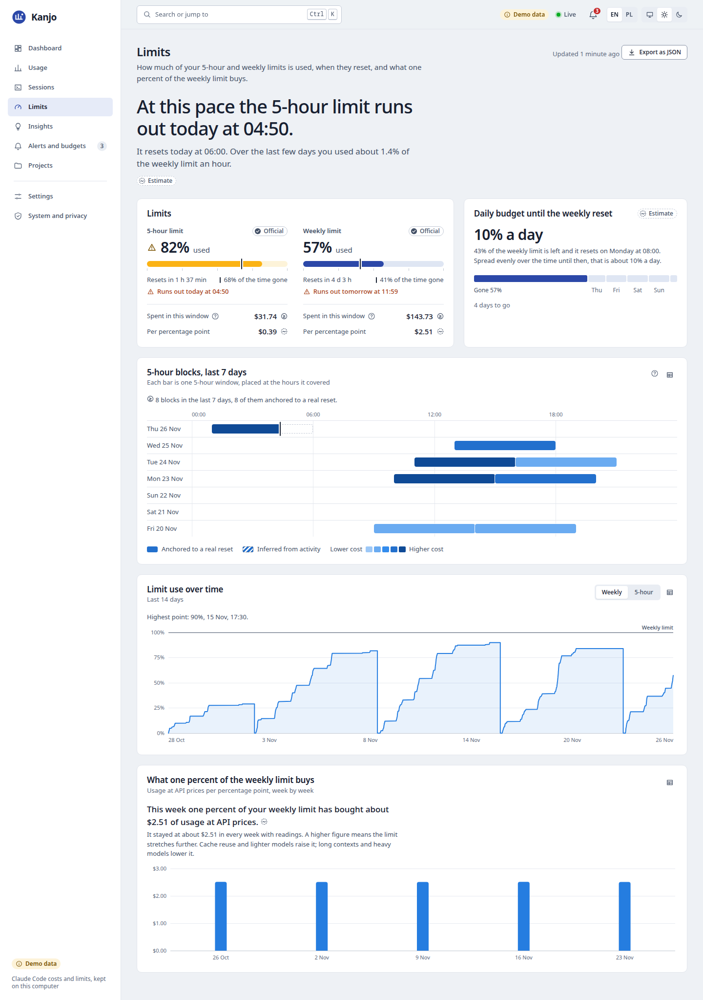
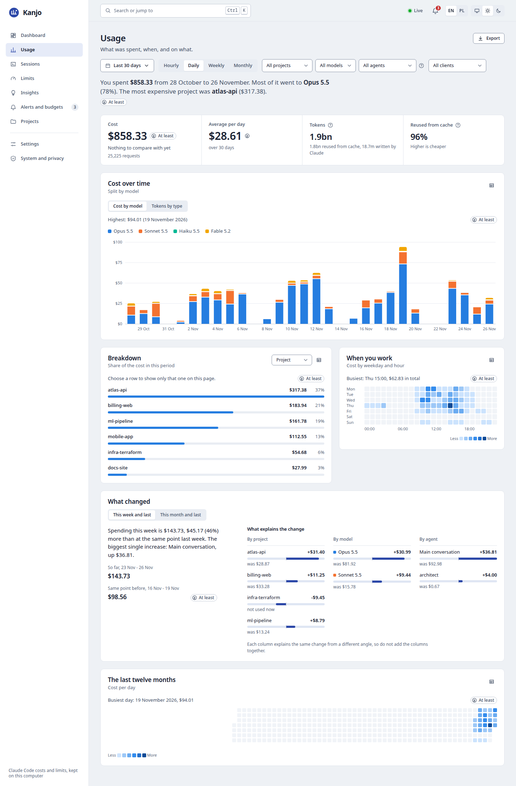
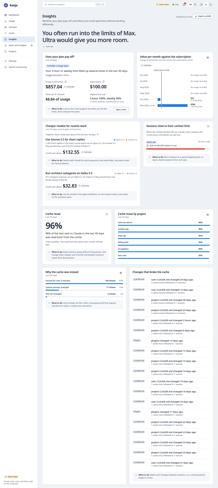

[Polski](README.pl.md)

<h1 align="center">Kanjo</h1>

<p align="center"><b>Know when Claude Code will hit your limit, and what burned it.</b></p>

<p align="center">An offline cost and limit monitor for Claude Code. It forecasts your 5-hour and weekly limits and shows what the work cost by project, model, subagent, skill, MCP server and tool. One Rust binary with the dashboard built in, and nothing it collects leaves your computer.</p>

<p align="center">
  <a href="LICENSE"></a>
  <a href="https://github.com/Kyotu-Technology/kanjo/actions/workflows/ci.yml"></a>
  <a href="https://github.com/Kyotu-Technology/kanjo/releases/latest"></a>
  
  <a href="scripts/egress-test.sh"></a>
  
  
</p>

<p align="center"><a href="#install">Install</a> · <a href="#what-kanjo-answers">What it answers</a> · <a href="#privacy-and-security">Privacy</a> · <a href="#documentation">Docs</a> · <a href="#built-by-kyotu-technology">Kyotu Technology</a></p>

<picture>
  <source media="(prefers-color-scheme: dark)" srcset="docs/screenshots/dashboard-dark.png">
  
</picture>
<p align="center"><sub>Every figure in the screenshots is synthetic demo data from <code>kanjo demo</code>.</sub></p>

| ~18 MB | 0 | 479 | 14 | 5 | 24 |
| :---: | :---: | :---: | :---: | :---: | :---: |
| one binary: collector, API and dashboard | outbound connections, checked by a zero-egress test in CI | Rust and web UI tests on every pull request and push to main | CI jobs on Ubuntu, macOS and Windows | release targets, each signed and shipped with SBOM and provenance | priced models; an unknown one is never guessed |

## Install

**macOS and Linux**

```sh
curl -fsSL https://github.com/Kyotu-Technology/kanjo/releases/latest/download/install.sh | sh
```

**Windows (PowerShell)**

```powershell
irm https://github.com/Kyotu-Technology/kanjo/releases/latest/download/install.ps1 | iex
```

**Homebrew (macOS and Linux)**

```sh
brew install kyotu-technology/tap/kanjo
```

The scripts check the archive against the release's `SHA256SUMS` and, when cosign is installed, its Sigstore signature, and need no sudo or administrator rights. The Homebrew formula installs the same archive, pinned to its SHA-256. Then:

```sh
kanjo demo    # 30 days of synthetic data in a temporary directory, no account, never reads ~/.claude
kanjo up      # connect Claude Code: status line, session hooks, background service, dashboard
```

`kanjo up` lists what it will change in Claude Code's `settings.json`, keeps a backup of the file and asks before it changes anything; `kanjo uninstall` undoes it. Options, verification and the full walk-through are in [docs/install.md](docs/install.md).

## What Kanjo answers

The name comes from the Japanese 勘定 (kanjō), the reckoning: the bill you ask for at the end of a meal. The dashboard is built around the questions a developer on a Pro, Max, Ultra or Team plan or on API billing asks, and the ones the person paying for it asks. It is in English and Polish, with light and dark themes and a mobile layout.

**When will I hit my limit?** Claude Code reports the official 5-hour and 7-day percentages to its status line (a verified Ultra account has only the weekly limit), and Kanjo records every reading. From the recent pace it forecasts when each limit runs out, shows when it resets and works out a daily budget until the weekly reset, so you slow down on Tuesday instead of finding out on Thursday.

**What did this cost, and where did it go?** Every request is priced at API list prices: cost today, this week and this month, broken down by project, model, subagent, skill, MCP server, tool, git branch, request source and client. A period comparison explains what grew since last week or last month.

**Is our plan the right one?** Kanjo compares the API-equivalent value of your usage with what your subscription costs and suggests keeping the plan, moving up or down a tier (Pro, Max and Ultra, or the Standard and Premium seats of the Team plan), or switching to API billing.

**Where are we wasting money?** The Insights page shows how much comes back from the prompt cache and why it broke, suggests a cheaper model mix with an estimated saving, and lists sessions close to their context limit.

**Will someone tell me before it happens?** Alerts fire at limit thresholds, when the forecast says a limit will run out before it resets, on budgets per project, client, day, week or month, and on cost spikes, runaway sessions and agent loops. They appear in the dashboard and as desktop notifications; nothing goes by e-mail or chat.

<p align="center">
  
  
  
</p>
<p align="center"><sub>Limits, Usage and Insights, on demo data.</sub></p>

**Inside Claude Code**, `kanjo up` installs a status line such as `Opus | $1.23 | 5h 42% 59m | 7d 63% 2d23h`. If you already have one, Kanjo runs in front of it in chain mode and your status line keeps showing.

**Getting the numbers out**: `kanjo daily`, `weekly`, `monthly`, `session` and `blocks` print tables, CSV with `--csv` or JSON in ccusage's shape with `--json`; `kanjo export` writes seven views to CSV or JSON, and the same data is served by the local [JSON API](docs/api.md).

Every figure carries a label. **Official** comes from Claude Code itself, **Estimate** is worked out by Kanjo, and **At least** is summed from the transcripts at API list prices, which can miss a request, so the real cost is at least the figure shown. A model missing from the price table is counted as unpriced, never as free. More in [docs/features.md](docs/features.md).

## Privacy and security

Kanjo reads the files Claude Code writes on your machine. It needs no account, does not talk to Anthropic and does not read your Claude credentials. The parser keeps usage numbers and metadata only: no prompt or response text is ever stored, logged or exported.

There are no outbound connections: no telemetry, no update check, no price download. cargo-deny keeps HTTP client crates out of the 282-crate dependency tree, and a CI job runs the binary in a loopback-only network namespace and again under `strace`, and fails on any connection other than loopback, a local socket or DNS.

The database is encrypted with SQLCipher, with its key in the system keyring. The dashboard listens on `127.0.0.1` behind an access token, and exports, settings changes and deletions go into a hash-chained audit log.

The release workflow signs `SHA256SUMS` with keyless cosign and attaches build provenance and a CycloneDX SBOM to each of the five targets.

Details are in [docs/privacy.md](docs/privacy.md), the [threat model](docs/security/threat-model.md), the [data inventory](docs/security/data-inventory.md) and [SECURITY.md](SECURITY.md). [docs/security/iso27001.md](docs/security/iso27001.md) maps Kanjo's features to ISO/IEC 27001:2022 Annex A controls to support an organisation's own ISMS; it is not a certification and makes no compliance claim on the organisation's behalf.

## Documentation

| Page | What it covers |
| --- | --- |
| [Install and first run](docs/install.md) | Install options, building from source, what `kanjo up` changes, `kanjo uninstall` |
| [What Kanjo answers](docs/features.md) | Every page in detail, how far each number can be trusted, how it works |
| [Privacy and security](docs/privacy.md) | What is stored, encryption, access token, audit log, retention |
| [Command reference](docs/cli.md) and [configuration](docs/configuration.md) | Every command, `config.toml`, data directories, prices and currency |
| [HTTP API](docs/api.md) and [architecture](docs/architecture.md) | The local JSON API and the design of the eight crates |
| [Status](docs/status.md), [feature status](docs/feature-status.md) and [releases](docs/release.md) | What was tested where, known limitations, verifying a download |

## Status

Kanjo works for one person on one machine. CI tests it on Ubuntu 24.04, macOS 15 and Windows Server 2025, the Linux one-line install has been run against the published release, and the whole path from install to uninstall has been run on Windows 11 in a virtual machine, with the installer as it was before its rework for piped use. The published release has not been installed by hand on macOS or Windows, and `kanjo up` and the background service have not been run on a Mac by hand. History reaches only as far back as the transcripts still on disk, so install Kanjo early. Platforms checked and known limitations are in [docs/status.md](docs/status.md).

## Built by Kyotu Technology

Kanjo is built and maintained by [Kyotu Technology](https://www.kyotutechnology.com/), a software company that builds custom software, web systems, mobile apps and cloud/DevSecOps solutions for clients across healthcare, fintech and energy, headquartered in Warsaw with offices in Wrocław, Austin and New York. Kyotu Technology runs Claude Code in its own delivery work: read about [Claude Code agent teams in production](https://kyotutechnology.com/claude-code-agent-teams-in-production-api-migration/) and [rebuilding its website with Claude Code](https://kyotutechnology.com/how-we-rebuilt-our-website-with-claude-code/).

Kyotu Technology is [ISO/IEC 27001:2022 certified](https://www.kyotutechnology.com/iso-27001-2022-certification-kyotu-technology/) by DEKRA Certification (certificate no. 00082600610, valid until 17 August 2029), with AI/ML/LLM solutions and DevOps in the certified scope. The certificate is the company's: Kanjo itself is not certified, and ships a [mapping of its features to Annex A controls](docs/security/iso27001.md) instead.

Rolling out AI coding agents and want cost, control and security to hold up? [Talk to Kyotu Technology](https://www.kyotutechnology.com/contact/).

## Acknowledgements

Kanjo stands on ideas from tools that came before it. ccusage shaped the period reports and their `--json` format, cctally's local dashboard, limit forecasts and cost per percent of the weekly limit shaped the Limits page, Claude-Code-Usage-Monitor the confidence labels and history-based limit estimates, and ccstatusline the status line and its chain mode. Prices come from the model price data published by the LiteLLM project.

## Contributing, security and licence

Contributions are welcome: [CONTRIBUTING.md](CONTRIBUTING.md) explains how to build and test and the rules every change follows. Please report vulnerabilities privately as described in [SECURITY.md](SECURITY.md), not in a public issue. Changes are listed in [CHANGELOG.md](CHANGELOG.md).

Kanjo is copyright Kyotu Technology and licensed under the [Apache License 2.0](LICENSE). The binary includes SQLCipher and OpenSSL; their notices are in [NOTICE](NOTICE).

"Claude" and "Claude Code" are trademarks of Anthropic. Kanjo is an independent open-source project by Kyotu Technology. It is not affiliated with, endorsed by or sponsored by Anthropic, and it uses those names only to say what it works with.
