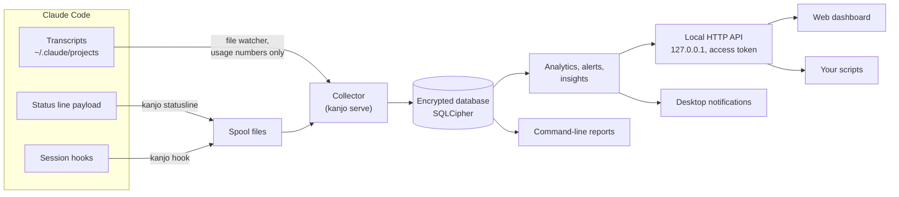

[Polski](README.pl.md)

# Kanjo

[](LICENSE)
[](https://github.com/Kyotu-Technology/kanjo/actions/workflows/ci.yml)

**An offline cost and limit monitor for Claude Code.** Kanjo tells you when you will hit your 5-hour and weekly limits, what this week cost, and where the money went: which project, model, subagent, skill, MCP server or tool. It is one program with a web dashboard built in, it runs on your own computer, and nothing it collects ever leaves that computer.

The name comes from the Japanese 勘定 (kanjō), the reckoning: the bill you ask for at the end of a meal.

**Try it with one command.** Once the `kanjo` binary is on your machine (see [Install](#install-and-first-run)), run:

```sh
kanjo demo
```

This opens the dashboard with 30 days of invented data, marked "Demo data" in the top bar and the sidebar. It needs no account and no configuration, it does not read your Claude Code files, and it keeps everything in a temporary directory. When you want your own numbers, run `kanjo up`, which shows what it will change and asks first.


*The dashboard, here on demo data: when the limits run out at the current pace, what today, this week and this month cost, and where the money went.*

Kanjo is published by Kyotu under the Apache License 2.0. It is an independent project and is not affiliated with or endorsed by Anthropic.

[What it answers](#what-kanjo-answers) · [How far to trust a number](#how-far-each-number-can-be-trusted) · [Install](#install-and-first-run) · [Privacy and security](#privacy-and-security) · [How it works](#how-it-works) · [Commands](#command-reference) · [Configuration](#configuration) · [Status and roadmap](#status-and-roadmap) · [Contributing](#contributing-security-and-licence)

## What Kanjo answers

A developer on a Pro or Max subscription, or on API billing directly or through a gateway, wants to know whether today's work will run into a limit. Someone in finance or operations wants to know what Claude Code costs and whether the plan is the right one. The dashboard is organised around those questions. It is available in English and Polish, with light and dark themes and a mobile layout.

### When will I hit my limit?

Claude Code reports the official 5-hour and 7-day usage percentages to its status line, and Kanjo records each reading. From the pace of the last few hours it forecasts when each limit runs out ("at this pace the 5-hour limit runs out today at 16:10"), shows when each one resets, and works out a daily budget until the weekly reset, so you can see whether to slow down on Tuesday rather than discover it on Thursday. It also tracks what one percent of the weekly limit buys at API prices, week by week, which shows whether the limit stretches further or less far as your way of working changes. 5-hour blocks are drawn on a timeline anchored to the real reset times.


*The Limits page.*

### What did this cost, and where did it go?

Every request in Claude Code's transcripts is priced at API list prices, so you see cost today, this week and this month, a spending rate per hour and a projection for the current 5-hour block. The Usage page breaks the cost down by project, model, subagent, skill, MCP server and tool, as well as by git branch, by request source (the part of Claude Code that sent the request, such as the main conversation or a compaction) and by client once you assign projects to clients. A period comparison explains what grew: this week against the same point last week, or this month against last month, by project, model and agent. Heatmaps show cost by weekday and hour and over the last twelve months. Days, weeks and months follow the system time zone, including the days on which daylight saving time starts or ends. Input, output, cache reads and both cache-write lifetimes are kept separately.


*The Usage page.*

### Is our plan the right one?

Kanjo compares the API-equivalent value of your usage with the price of your subscription (you choose the plan and can enter what you actually pay). It then suggests keeping the plan, moving up a tier because you keep reaching the limits, moving down because the limits are rarely used, or switching to API billing because the work would cost less there.

### Where are we wasting money?

The Insights page shows how much of what is sent to the model comes back from the prompt cache, per project and session, and when the cache broke, why: Claude Code's reported cause of the miss, and changes to CLAUDE.md, settings, plugins or the set of tools that line up with it. It suggests a cheaper model mix where one fits, for example a smaller model for short replies or for a particular subagent, with an estimated saving. It lists sessions that are close to their context limit, and the alert engine flags cost spikes, runaway sessions and agent loops.


*The Insights page.*

### Will someone tell me before it happens?

Alerts fire at limit thresholds (80, 90 and 95 percent by default, once per window), when the forecast says a limit will run out before it resets, when a budget is close or exceeded, on cost anomalies, a cold cache and long contexts. Budgets can be set for all usage, a project or a client, per day, week or month. Alerts appear in the dashboard and as desktop notifications, and can ring the terminal bell when the server runs in a terminal (`kanjo serve`; under the background service there is no terminal, and Settings says so). Nothing is sent by e-mail or to a chat service.

### And inside Claude Code itself?

`kanjo up` installs a status line that shows the model, the session cost, both limits and the time to their reset, and the cache state when Claude Code reports it, for example:

```
Opus | $1.23 | 5h 42% 59m | 7d 63% 2d23h
```

If you already use a status line of your own, Kanjo goes in front of it in chain mode: it records the payload, then runs your command with the same input and shows its output, so your status line keeps working.

### Can I get the numbers out?

The command line prints the same reports as the dashboard (`kanjo daily`, `weekly`, `monthly`, `session`, `blocks`, `status`) as tables or, with `--json`, as JSON; all of them except `status` also print CSV with `--csv`. The JSON of the period reports follows the shapes of ccusage's `--json` output (modelled on its documentation, not yet tested against ccusage itself). `kanjo export` writes the usage, breakdown, sessions, blocks, turns, alerts and audit views to CSV or JSON, and the same views are available from the local JSON API under `/api/v1`, described in [docs/api.md](docs/api.md).

## How far each number can be trusted

Every figure in Kanjo carries one of three labels, in the dashboard and in the command line.

**Official** figures come from Claude Code itself: the 5-hour and weekly limit percentages, their reset times and the session cost that Claude Code reports to its status line. Kanjo stores them as they arrive.

**Estimates** are worked out by Kanjo: forecasts, the daily budget, plan advice, savings from a different model mix, and limit percentages calibrated from history when no status line reading exists.

**Lower bounds** (shown as "At least") are costs summed from the transcripts at API list prices. The transcripts are the only record of individual requests, but they can miss some (retries or interrupted responses, for example), so the real figure is at least the one shown. A model that is missing from the price table is never counted as free and never given a guessed price: its requests are counted as unpriced and the dashboard says so.

Two more things are worth knowing. API list prices are what the work would cost on pay-as-you-go billing; on a subscription you pay the plan price, which is why Kanjo shows both. And the limit percentages only exist when Claude Code sends them to the status line, which it does for Pro and Max subscriptions (and behind some gateways), after the first response of a session and while a session runs. Without the status line installed, Kanjo can only estimate them.

## Install and first run

Kanjo is a single binary with no runtime dependencies. You can install a release with a script or build it from source; then `kanjo up` connects it to Claude Code.

> No release has been published yet, so the install scripts have nothing to download today. Building from source is the path that works now. See [Status and roadmap](#status-and-roadmap).

### With the install script

On **Linux and macOS**, download `install.sh` from the latest release, read it, and run it:

```sh
sh install.sh
```

The script detects the platform (Linux x86_64 or aarch64, using a static musl build that runs on any distribution; macOS on Intel or Apple silicon, including a native build when the shell runs under Rosetta), downloads the archive and checks it against the release's `SHA256SUMS`. When cosign is installed, it also checks that `SHA256SUMS` was signed by this repository's release workflow for exactly that version, and stops if not. Without cosign it says that no signature was checked and relies on the checksum alone. It installs `kanjo` into `~/.local/bin`, needs no sudo and changes nothing outside the install directory. If that directory is not on your `PATH`, it says how to add it. `sh install.sh --help` lists the options, among them `--version`, `--dir` and `--archive` for installing a downloaded archive offline.

On **Windows**, download `install.ps1`, read it, and run:

```powershell
powershell -ExecutionPolicy Bypass -File install.ps1
```

It performs the same checks, installs `kanjo.exe` into `%LOCALAPPDATA%\Programs\Kanjo` and adds that directory to your user `PATH`. No administrator rights are needed; the parameters mirror the shell script's (`-Version`, `-Dir`, `-Archive`, `-NoPathUpdate` and others).

The scripts contact GitHub to download the release. Kanjo itself never does; with `--archive` (`-Archive`) the scripts work offline too. How to verify a download by hand is described in [docs/release.md](docs/release.md).

### From source

You need Rust 1.91 or newer (the `rust-version` in `Cargo.toml`), a C compiler and Perl, because the database layer compiles SQLCipher and OpenSSL from source; on Windows that means the MSVC build tools and Strawberry Perl. The web UI needs Node.js and npm (CI uses Node 24).

```sh
git clone https://github.com/Kyotu-Technology/kanjo
cd kanjo
(cd web && npm ci && npm run build)
cargo build --release -p kanjo
./target/release/kanjo demo
```

The first build compiles the C code and takes a few minutes. Building downloads crates and npm packages; the binary it produces makes no network connections.

### Connecting Claude Code: `kanjo up`

`kanjo up` finds Claude Code's directory (`~/.claude`, or `CLAUDE_CONFIG_DIR`), lists what it is about to do, and asks before changing anything. Running it again is safe. It makes three kinds of change.

**Claude Code's `settings.json`.** Kanjo adds a `statusLine` entry that runs `kanjo statusline` and three hooks, `SessionStart`, `Stop` and `SessionEnd`, that run `kanjo hook` to note when sessions start and end. The commands use the full path of the binary (and `--home DIR` if you use a non-default data directory). If you already have a status line, Kanjo puts itself in front of it and remembers your command in its own `config.toml`; your status line keeps showing. Everything else in the file stays as it was, including key order and indentation. Before changing the file Kanjo copies it to `settings.json.kanjo-backup-<UTC timestamp>` next to it, and the new version is written atomically. If the file is not valid JSON, Kanjo refuses to touch it.

**A per-user background service** that runs `kanjo serve` when you log in, so data is collected even when the dashboard is closed. No administrator rights are involved:

| Platform | What is installed |
| --- | --- |
| Linux | systemd user unit `~/.config/systemd/user/kanjo.service`, enabled and started with `systemctl --user` |
| macOS | LaunchAgent `~/Library/LaunchAgents/io.kyotu.kanjo.plist`, loaded with `launchctl` |
| Windows | a value named `Kanjo` under `HKCU\Software\Microsoft\Windows\CurrentVersion\Run` that starts a windowless launcher script, `%LOCALAPPDATA%\Kyotu\kanjo\service\kanjo-service.vbs`, at logon (a logon entry, not a Windows service) |

**Kanjo's data directory** (see [Configuration](#configuration)), with the encrypted database, `config.toml`, the access token and backups. On first start Kanjo imports the transcript history that is still on disk and then follows new requests as they are written.

Finally it opens the dashboard in your browser and signs you in. `--no-hooks` leaves `settings.json` alone, `--no-service` runs the dashboard in the terminal instead of installing a service, `--no-open` skips the browser, and `--yes` skips the question. The **System and privacy** page of the dashboard shows the state of each piece and can connect or disconnect them too.

### Undoing it: `kanjo uninstall`

`kanjo uninstall` removes Kanjo's status line from `settings.json` (putting back your previous status line if Kanjo was chained in front of it), removes its three hooks, and stops and removes the background service. Your Kanjo data stays unless you add `--purge-data`, which deletes the data directory; it refuses while a Kanjo server is still running and refuses a directory that does not look like Kanjo's. Three things are left for you to remove by hand if you want: the `settings.json.kanjo-backup-*` copies, the binary itself (and on Windows the `PATH` entry the installer added), and, if the database key was kept in the system keyring, its `kanjo` entry.

## Privacy and security

Kanjo reads files that Claude Code writes on your machine. It needs no account, does not talk to Anthropic and does not read your Claude credentials.

**No outbound connections.** There is no telemetry, no update check, no crash reporting and no price download; the price table is compiled into the binary. This is enforced in two ways. `deny.toml` makes cargo-deny reject HTTP, SMTP, DNS, telemetry and update client crates (and the client features of hyper), so they cannot enter the dependency tree. `scripts/egress-test.sh` runs the binary in demo mode inside a network namespace that has only loopback, and again under `strace`, and fails if any connection goes anywhere but loopback or a local socket. Both are jobs in the CI workflow and pass there. If you ever see Kanjo open a non-loopback connection, that is a vulnerability; please report it.

**No prompt or response text is stored.** The parser keeps usage numbers and metadata only. For each request that is the time, the model, the token counts by type, the computed cost, session and request ids, the project directory and working directory, the git branch, the Claude Code version, the request source, the names of the tools, MCP servers, skills and subagents involved, the opaque account id when the transcript carries one, and technical fields such as the service tier, speed, effort level and stop reason. From the status line Kanjo keeps limit percentages and reset times, the session cost, context usage and the reported causes of cache misses; from the hooks, session start and end times. To find what broke the cache it fingerprints files such as CLAUDE.md by size, modification time and SHA-256; their content is hashed and dropped. Session titles, which summarise conversation content, are stored only if you turn that on. A record Kanjo does not recognise is set aside by its type and the names of its fields, never with its content. The optional transcript viewer is off by default, reads the transcript file on demand without copying it, and writes every view to the audit log.

**Path redaction.** Project paths and branch names are stored because they are how costs are attributed. With redaction turned on (Settings), the dashboard, exports and command line show stable per-installation aliases instead of project names, paths, branches and client names.

**Encryption at rest.** The database is encrypted with SQLCipher. By default (`encryption = "auto"`) the key is kept in the operating system's keyring under the service name `kanjo`: Secret Service on Linux, the Keychain on macOS, Credential Manager on Windows. Where no keyring is available, it goes into an owner-only key file, `kanjo.key`, in the data directory. Backups are encrypted with the same key, so keep the key: without it neither the database nor its backups can be opened. On Linux and macOS the data directory is readable by its owner only.

**Loopback only, with an access token.** The dashboard listens on `127.0.0.1:4747` by default. Every API request except a health check needs the access token, stored owner-only in the data directory, either as a session cookie or as a bearer token. The token never appears in a URL: `kanjo open` and `kanjo up` sign the browser in with a login code that works once, for two minutes, and only for the server instance it was written for. The code does not appear on the command line of the program that opens the browser either. `kanjo open`, `kanjo up` and the browser that `kanjo serve` or `kanjo demo` opens get an owner-only page in the `open` folder of the data directory, named by a digest rather than the code, which forwards the browser to the sign-in address. The page is deleted when the code is used, after 20 seconds, or when a server starts. If the browser has not signed in within 20 seconds, `kanjo open` and `kanjo up` print the address to open by hand and the server logs a warning; `kanjo open --json` prints the address without opening anything. With authentication off (`auth = "none"`, loopback only) the plain address is opened. Wrong credentials are rate-limited. Listening on any other address is refused unless TLS and token authentication are both configured.

**Audit log.** Exports, transcript views, settings changes, deletions, backups, restores, price imports and changes to the Claude Code integration and the service are written to a hash-chained audit log. `kanjo audit list` shows the newest entries and `kanjo audit verify` checks that none was changed or removed outside retention.

**Retention and deletion on request.** Each kind of data has its own retention period, set in Settings and applied daily: by default request rows are kept for 400 days, hourly aggregates indefinitely, limit readings and the audit log for 400 days, alerts for 180 days and set-aside records for 90 days. `kanjo purge` deletes one project, one session, everything before a date, or everything; deleted history is not read in again by a later rescan.

**Signed releases with an SBOM, as designed.** The release workflow builds from the tagged commit, signs `SHA256SUMS` with Sigstore cosign, and attaches build provenance attestations and a CycloneDX SBOM to every archive. It has not been executed yet; see [docs/release.md](docs/release.md) and [SECURITY.md](SECURITY.md).

**ISO/IEC 27001.** Kanjo documents how its features map to ISO/IEC 27001:2022 Annex A controls to support an organisation's own ISMS; it is not a certification and makes no compliance claim on the organisation's behalf. See [docs/security/iso27001.md](docs/security/iso27001.md).

## How it works

Kanjo has three sources, all on the local machine. The **transcripts** that Claude Code writes under `~/.claude/projects` hold one record per request with its model and token counts; Kanjo imports the history once and then watches the files, reading only what was appended. The **status line payload** that Claude Code passes to `kanjo statusline` on every update carries the official limit percentages, the session cost, context usage and cache information. The **session hooks** mark when sessions start and end. Claude Code runs the status line and hook commands itself, so they are kept fast: they open no database, only append the payload to a spool file in the data directory (the status line also prints its text), and the collector moves it into the database.



The code is a Rust workspace of eight crates with one job each: `kanjo-core` (types, storage, prices), `kanjo-ingest` (transcript parsing and watching), `kanjo-analytics` (every report), `kanjo-alerts` (alerts, budgets and insights), `kanjo-ops` (keys, audit, retention, backups, price import), `kanjo-setup` (Claude Code integration, the service, `kanjo doctor`), `kanjo-server` (HTTP API and the embedded UI) and `kanjo-cli` (the `kanjo` binary). The dashboard is a Svelte application in `web/`, built before the binary and embedded in it, so it loads nothing from the internet. [docs/architecture.md](docs/architecture.md) explains the design and [docs/api.md](docs/api.md) the HTTP API.

## Command reference

Every command accepts `--home DIR` (the data directory), `--claude-dir DIR` (Claude Code's directory), `--lang en|pl`, `--no-color` and `--json`. `kanjo <command> --help` describes each one.

| Command | What it does |
| --- | --- |
| `kanjo up` | Connect Claude Code, install the background service and open the dashboard. `--yes`, `--no-hooks`, `--no-service`, `--no-open` |
| `kanjo demo` | The dashboard with invented data in a temporary directory. `--port N`, `--days N`, `--no-open` |
| `kanjo open` | Open the dashboard and sign the browser in |
| `kanjo status` | Limits, forecast and spending at a glance |
| `kanjo doctor` | Check the installation and say what to fix |
| `kanjo daily`, `weekly`, `monthly`, `session`, `blocks` | Cost reports. `--since` and `--until` (YYYY-MM-DD, local days), `--project NAME`, `--model NAME`, `--breakdown` (per model; `blocks` also lists the top three projects), `--csv`, or `--json` in the ccusage shape |
| `kanjo export VIEW --format csv\|json` | Write `usage`, `breakdown`, `sessions`, `blocks`, `turns`, `alerts` or `audit` to a file with `-o FILE`. `--by` picks the breakdown dimension (project, model, agent, skill, mcp, tool, branch, client, session, query-source), `--group` the bucket (hour, day, week, month) |
| `kanjo serve` | Run the server in this terminal (what the service runs). `--port N`, `--bind ADDR`, `--no-open` |
| `kanjo import` | Read transcripts into the database now; `--rescan` reads everything again without counting anything twice |
| `kanjo backup create`, `backup list`, `restore FILE` | Back up the database and restore a backup (restore refuses while Kanjo runs) |
| `kanjo pricing show`, `import FILE`, `reset` | Show, replace or reset the price table (see [Configuration](#configuration)) |
| `kanjo purge` | Delete stored data: `--project NAME`, `--session ID`, `--before DATE` or `--all` |
| `kanjo retention apply` | Apply the retention settings now |
| `kanjo audit list`, `audit verify` | Show the audit log, check its hash chain |
| `kanjo service install`, `uninstall`, `status` | Manage the background service on its own |
| `kanjo uninstall` | Remove Kanjo from Claude Code and stop the service. `--purge-data`, `--yes` |
| `kanjo completions SHELL` | Shell completion for bash, zsh, fish, elvish or PowerShell |

`kanjo statusline` and `kanjo hook` are run by Claude Code, not by you.

## Configuration

Most settings (your plan and what you pay for it, display currency, alert thresholds, privacy, retention, language, theme, first day of the week) are changed in the dashboard and stored in the database. A few things that are needed before the database opens live in `config.toml` in the data directory.

| Platform | Data directory |
| --- | --- |
| Linux | `$XDG_DATA_HOME/kanjo`, by default `~/.local/share/kanjo` |
| macOS | `~/Library/Application Support/io.Kyotu.kanjo` |
| Windows | `%APPDATA%\Kyotu\kanjo\data` |

`--home DIR` or the `KANJO_HOME` environment variable choose another directory, and `--claude-dir DIR`, `KANJO_CLAUDE_DIR` or `CLAUDE_CONFIG_DIR` point Kanjo at a Claude Code directory other than `~/.claude`. `KANJO_NO_KEYRING=1` keeps the database key in the key file instead of the system keyring.

```toml
[server]
bind = "127.0.0.1"   # another address needs tls_cert, tls_key and auth = "token"
port = 4747
auth = "token"       # "none" is accepted on loopback only
# tls_cert = "/path/to/cert.pem"
# tls_key = "/path/to/key.pem"

[storage]
encryption = "auto"  # "keyring", "keyfile" or "off"; set before the first start

[statusline]
chain_command = "..."  # your previous status line, written by kanjo up
show_segment = false   # also print Kanjo's own segment when chaining
```

Encryption has to be decided before the database is created: Kanjo cannot encrypt an existing unencrypted database. To start over encrypted, move the database out of the data directory, set `encryption = "auto"` in the `[storage]` section of `config.toml` and run `kanjo import`; history older than the transcripts still on disk is lost. `kanjo doctor` and the System and privacy page say the same.

**Prices.** Costs use a price table compiled into the binary, generated from LiteLLM's model price data and versioned by date; `kanjo pricing show` shows which one is in use. To update prices without a network connection, import a file that uses the same LiteLLM field names. A signed file is checked against the minisign public key you trust:

```sh
kanjo pricing import prices.json --sig prices.json.minisig --pubkey minisign.pub
```

A file without a signature is accepted only with `--allow-unsigned`, and is recorded as unsigned. Kanjo has no built-in trusted key, so the trust decision is yours. An import reprices all stored history in one step and is written to the audit log; `kanjo pricing reset` goes back to the built-in table.

**Currency.** Prices are always computed in US dollars. In Settings you can pick a display currency and enter the exchange rate yourself, because Kanjo never fetches rates. The dashboard and alert texts use it; command-line reports and exports stay in US dollars.

## Status and roadmap

Kanjo is at version 0.1.0 and no release has been tagged yet. This is what has been checked, and how:

| Platform | State | How it was verified |
| --- | --- | --- |
| Linux x86_64 | Built and tested | Test suite; manual runs in temporary directories; during development, an import of about 7 GB of real transcripts in under 10 seconds, with token totals cross-checked against a separate `jq` computation and the price table checked against the costs Claude Code records itself; a static musl build made and run in an Alpine container, packaged with `scripts/release-package.sh`, installed from the archive by `install.sh` and started with `kanjo up` in a scratch home (each step well under a second); the `strace` phase of the egress test; `scripts/test-install.sh` |
| Linux aarch64 | Defined in the release workflow | Not yet built |
| macOS (Intel and Apple silicon) | Tested in CI on Apple silicon | The test suite passes on GitHub's macOS 15 runner, and release binaries for both architectures compile and link (`scripts/cross-check.sh macos`). The install script, `kanjo up` and the background service have not been run on a Mac by hand |
| Windows x86_64 | Installed and run on Windows 11 in a virtual machine | `scripts/windows-vm-test.sh` installs a real Windows 11 (evaluation image, Windows PowerShell 5.1) and runs the whole path there: `install.ps1` from the packaged zip, `kanjo up` with the logon entry and the database key in the Windows credential store, the dashboard, the status line, live file watching, the reports and `kanjo uninstall`. `scripts/cross-check.sh windows` lints the workspace for Windows and runs the test suite under Wine. The binary in the virtual machine was the `x86_64-pc-windows-gnu` cross-build; the MSVC build is compiled, tested and checked for runtime dependencies by CI on Windows Server 2025 |

The background service and `kanjo uninstall` have been run for real only on Windows 11, in the virtual machine test, which also keeps the database key in the Windows credential store. On Linux and macOS that code is covered by tests that never call `systemctl` or `launchctl`, and the keyring backends there were tested only through a stand-in. CI runs the test suite on Ubuntu, on macOS 15 (Apple silicon) and on Windows Server 2025 (MSVC build), together with the zero-egress test and the dependency checks. The release workflow (signing, SBOMs, attestations) has not been executed yet, so there is no release to download.

**Known limitations** that a user may run into:

- Kanjo is for one person on one machine. There is no team view yet.
- History reaches only as far back as the transcripts on disk. Claude Code deletes old transcripts (after 30 days unless `cleanupPeriodDays` says otherwise), so install Kanjo early; from then on it keeps its own copy.
- The transcript format is undocumented. After a Claude Code update, records Kanjo does not recognise are set aside rather than guessed at; `kanjo doctor` and the System page list them.
- Usage beyond the plan ("extra usage") is not tracked; only the spend limit that gateways report is shown.
- The command line and the API export seven views; the Limits, Insights and Projects pages export their data as JSON from the browser.
- Breakdowns by git branch, session, skill, MCP server, tool and request source are read from individual request rows, so they reach back only as far as request retention keeps them (400 days by default).
- Claude Code does not document its request sources. Only the main conversation (`repl_main_thread`) and compaction (`compact`) are confirmed from real records. The dashboard's names "Helper agent" (values starting with `agent`) and "Session title" (values containing `title`) are guesses; other values are shown as recorded, and requests without a source as "Not recorded".
- Hourly totals are stored per UTC hour. In a time zone with a fractional offset, such as UTC+5:30 or UTC+5:45, a day or bucket edge built from them is approximate to the hour. Cost-spike detection reads individual requests and stays exact.
- Kanjo writes UTF-8. Windows PowerShell 5.1 decodes the output of a program it captures or pipes with the console code page, so Polish letters in captured output come out wrong there unless that code page is UTF-8 (`chcp 65001`).
- Browsers installed as Snap or Flatpak packages may be unable to read the sign-in page in the data directory (or, for the demo, in the temporary directory). Then `kanjo open` and `kanjo up` print the address after 20 seconds. This has not been tested with a real sandboxed browser.
- In `kanjo demo`, the first-run guide still offers a Connect step, which the demo server refuses.
- There is no command to rotate the access token yet.
- The minisign key for releases has not been published, so the install scripts verify signatures only with cosign.

**Planned**, from the specification and not built yet:

- A team server in the LAN: the same binary in server mode, collecting aggregates from each machine and OpenTelemetry (OTLP) data from Claude Code, with SSO and roles, team budgets and chargeback per client. Prompt text would still never leave a developer's machine.
- A terminal UI for use over SSH.
- A Docker image for the team server.
- A desktop edition as a Tauri shell around the same server and web UI. [docs/desktop.md](docs/desktop.md) describes the seams that already exist for it.

## Acknowledgements

Kanjo stands on ideas from open-source tools that came before it. ccusage showed how much can be learned from Claude Code's transcripts and shaped the daily, weekly, monthly, session and block reports; Kanjo's `--json` output follows its format. cctally's local dashboard, limit forecasts and cost per percent of the weekly limit shaped the Limits page. Claude-Code-Usage-Monitor's practice of labelling where a number comes from, and its history-based limit estimates, shaped Kanjo's confidence labels. ccstatusline showed what a status line for Claude Code can carry, and Kanjo's chain mode exists so that status lines like it keep working. Prices come from the model price data published by the LiteLLM project.

## Contributing, security and licence

Contributions are welcome. [CONTRIBUTING.md](CONTRIBUTING.md) explains how to build and test, the rules every change must follow (among them: no prompt text stored, no outbound connections, synthetic fixtures only) and how to update the price table. Please report vulnerabilities privately as described in [SECURITY.md](SECURITY.md), not in a public issue. Changes are listed in [CHANGELOG.md](CHANGELOG.md).

Kanjo is copyright Kyotu and licensed under the [Apache License 2.0](LICENSE). The binary includes SQLCipher and OpenSSL; their notices are in [NOTICE](NOTICE).

"Claude" and "Claude Code" are trademarks of Anthropic. Kanjo is an independent open-source project by Kyotu. It is not affiliated with, endorsed by or sponsored by Anthropic, and it uses those names only to say what it works with.
