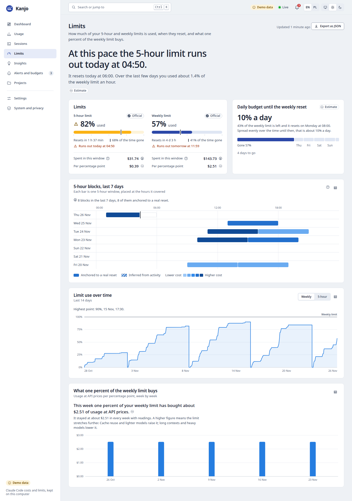
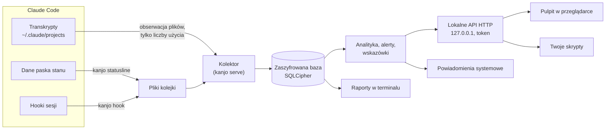

[English](README.md)

# Kanjo

[](LICENSE)
[](https://github.com/kyotu/kanjo/actions/workflows/ci.yml)

**Monitor kosztów i limitów Claude Code, który działa offline.** Kanjo mówi, kiedy skończy się limit 5-godzinny i tygodniowy, ile kosztował ten tydzień i na co poszły pieniądze: na który projekt, model, subagenta, skill, serwer MCP czy narzędzie. To jeden program z wbudowanym pulpitem w przeglądarce, działa na Twoim komputerze i nic, co zbiera, nie opuszcza tego komputera.

Nazwa pochodzi od japońskiego 勘定 (kanjō), czyli rachunku: tego, o który prosi się kelnera na koniec posiłku.

**Wypróbujesz je jednym poleceniem.** Gdy plik `kanjo` jest już na komputerze (zob. [Instalacja](#instalacja-i-pierwsze-uruchomienie)), uruchom:

```sh
kanjo demo
```

Otworzy się pulpit z 30 dniami zmyślonych danych, oznaczony na górnym pasku i w menu bocznym etykietą „Dane demonstracyjne”. Nie potrzeba konta ani konfiguracji, Kanjo nie czyta wtedy Twoich plików Claude Code i trzyma wszystko w katalogu tymczasowym. Gdy zechcesz zobaczyć własne liczby, uruchom `kanjo up`: pokaże, co zmieni, i najpierw zapyta o zgodę.


*Pulpit na danych demo: kiedy przy obecnym tempie skończą się limity, ile kosztował dzień, tydzień i miesiąc i na co poszły pieniądze. Zrzuty ekranu pokazują wersję angielską.*

Kanjo jest wydawane przez Kyotu na licencji Apache 2.0. To niezależny projekt, niepowiązany z Anthropic i przez Anthropic niepopierany.

[Na co odpowiada](#na-jakie-pytania-odpowiada-kanjo) · [Na ile ufać liczbom](#na-ile-można-ufać-liczbom) · [Instalacja](#instalacja-i-pierwsze-uruchomienie) · [Prywatność i bezpieczeństwo](#prywatność-i-bezpieczeństwo) · [Jak to działa](#jak-to-działa) · [Polecenia](#polecenia) · [Konfiguracja](#konfiguracja) · [Stan i plany](#stan-projektu-i-plany) · [Współpraca](#współpraca-bezpieczeństwo-i-licencja)

## Na jakie pytania odpowiada Kanjo

Programista na subskrypcji Pro lub Max, albo rozliczany za API bezpośrednio lub przez gateway, chce wiedzieć, czy dzisiejsza praca nie oprze się o limit. Ktoś z finansów albo operacji chce wiedzieć, ile kosztuje Claude Code i czy plan jest dobrze dobrany. Pulpit jest ułożony wokół tych pytań. Działa po polsku i po angielsku, w jasnym i ciemnym motywie, także na telefonie.

### Kiedy skończy mi się limit?

Claude Code przekazuje do paska stanu oficjalne procenty zużycia limitu 5-godzinnego i 7-dniowego, a Kanjo zapisuje każdy odczyt. Na podstawie tempa z ostatnich godzin prognozuje, kiedy każdy z limitów się wyczerpie („przy tym tempie limit 5-godzinny skończy się dziś o 16:10”), pokazuje, kiedy się odnowią, i wylicza dzienny budżet do resetu tygodniowego. Dzięki temu już we wtorek widać, że trzeba zwolnić, zamiast odkryć to w czwartek. Kanjo śledzi też, ile pracy po cenach API kupuje jeden procent limitu tygodniowego, tydzień po tygodniu, więc widać, czy limit starcza na więcej, czy na mniej, gdy zmienia się sposób pracy. Bloki 5-godzinne są rozrysowane na osi czasu i zakotwiczone w rzeczywistych momentach resetu.


*Strona Limity.*

### Ile to kosztowało i na co poszło?

Każde zapytanie zapisane w transkryptach Claude Code jest wyceniane po cenniku API, więc widać koszt dzisiaj, w tym tygodniu i w tym miesiącu, tempo wydawania na godzinę i prognozę dla bieżącego bloku 5-godzinnego. Strona Zużycie rozbija koszt na projekty, modele, subagentów, skille, serwery MCP i narzędzia, a także na gałęzie gita, na źródła zapytań (część Claude Code, która wysłała zapytanie, na przykład główna rozmowa albo kompaktowanie) i na klientów, gdy przypiszesz do nich projekty. Porównanie okresów wyjaśnia, co urosło: ten tydzień wobec tego samego momentu poprzedniego tygodnia albo ten miesiąc wobec poprzedniego, w podziale na projekty, modele i agentów. Mapy cieplne pokazują koszt według dnia tygodnia i godziny oraz w ciągu ostatnich dwunastu miesięcy. Dni, tygodnie i miesiące liczone są w systemowej strefie czasowej, także w dniach zmiany czasu na letni i zimowy. Tokeny wejściowe, wyjściowe, odczyty z cache i oba rodzaje zapisu do cache są liczone osobno.


*Strona Zużycie.*

### Czy mamy dobry plan?

Kanjo porównuje wartość użycia po cenach API z ceną subskrypcji (plan wybierasz sam i możesz wpisać kwotę, którą faktycznie płacisz). Na tej podstawie radzi zostać przy planie, przejść wyżej, bo limity często się kończą, zejść niżej, bo rzadko są wykorzystywane, albo przejść na rozliczenie za API, bo tam ta sama praca kosztowałaby mniej.

### Gdzie przepalamy pieniądze?

Strona Wskazówki pokazuje, jaka część tego, co trafia do modelu, wraca z cache promptów, w podziale na projekty i sesje, a gdy cache się psuje, podaje przyczynę: powód zgłoszony przez Claude Code i zbieżne w czasie zmiany w CLAUDE.md, ustawieniach, wtyczkach albo zestawie narzędzi. Podpowiada tańszy dobór modeli tam, gdzie ma to sens, na przykład mniejszy model do krótkich odpowiedzi albo dla konkretnego subagenta, z szacowaną oszczędnością. Wymienia sesje bliskie limitu kontekstu, a mechanizm alertów wychwytuje skoki kosztów, sesje, które wymknęły się spod kontroli, i pętle agentów.


*Strona Wskazówki.*

### Czy ktoś mnie uprzedzi?

Alerty pojawiają się po przekroczeniu progów limitu (domyślnie 80, 90 i 95 procent, raz na okno), gdy prognoza mówi, że limit skończy się przed resetem, gdy budżet jest bliski wyczerpania albo przekroczony, przy anomaliach kosztów, wystygłym cache i długim kontekście. Budżet można ustawić dla całego użycia, projektu albo klienta, na dzień, tydzień lub miesiąc. Alerty widać na pulpicie i jako powiadomienia systemowe, a gdy serwer działa w terminalu (`kanjo serve`), mogą też uruchomić dzwonek terminala (usługa w tle nie ma terminala i Ustawienia o tym informują). Nic nie idzie e-mailem ani na komunikator.

### A w samym Claude Code?

`kanjo up` instaluje pasek stanu z modelem, kosztem sesji, oboma limitami i czasem do ich odnowienia, a także stanem cache, gdy Claude Code go podaje, na przykład:

```
Opus | $1.23 | 5h 42% 59m | 7d 63% 2d23h
```

Jeśli masz już własny pasek stanu, Kanjo staje przed nim w trybie łańcucha: zapisuje dane, a potem uruchamia Twoje polecenie z tym samym wejściem i pokazuje jego wynik, więc Twój pasek działa dalej.

### Czy mogę wyciągnąć dane?

Wiersz poleceń drukuje te same raporty co pulpit (`kanjo daily`, `weekly`, `monthly`, `session`, `blocks`, `status`) jako tabele albo, z `--json`, jako JSON; wszystkie poza `status` drukują też CSV z `--csv`. JSON raportów okresowych ma kształt wyjścia `--json` z ccusage (wzorowany na jego dokumentacji, jeszcze nie sprawdzony z samym ccusage). `kanjo export` zapisuje do CSV lub JSON widoki użycia, podziału, sesji, bloków, tur, alertów i audytu, a te same widoki udostępnia lokalne API JSON pod `/api/v1`, opisane w [docs/api.md](docs/api.md).

## Na ile można ufać liczbom

Każda liczba w Kanjo, na pulpicie i w wierszu poleceń, ma jedną z trzech etykiet.

**Oficjalne** pochodzą od samego Claude Code: procenty limitu 5-godzinnego i tygodniowego, momenty ich resetu i koszt sesji, które Claude Code przekazuje do paska stanu. Kanjo zapisuje je tak, jak przychodzą.

**Szacunki** (etykieta „Szacunek”) wylicza Kanjo: prognozy, dzienny budżet, rady co do planu, oszczędności z innego doboru modeli oraz procenty limitu odtworzone z historii, gdy brakuje odczytu z paska stanu.

**Dolne granice** (na pulpicie „Co najmniej”) to koszty zsumowane z transkryptów po cenniku API. Transkrypty są jedynym zapisem pojedynczych zapytań, ale część zapytań może do nich nie trafić (na przykład ponowienia albo przerwane odpowiedzi), więc prawdziwa kwota jest co najmniej taka, jak pokazana. Model, którego nie ma w cenniku, nigdy nie jest liczony jako darmowy ani wyceniany na oko: jego zapytania są oznaczane jako niewycenione, a pulpit o tym informuje.

Warto pamiętać o dwóch rzeczach. Cennik API mówi, ile ta praca kosztowałaby przy rozliczeniu za zużycie; na subskrypcji płacisz cenę planu, dlatego Kanjo pokazuje oba. A procenty limitu istnieją tylko wtedy, gdy Claude Code wysyła je do paska stanu, co robi na subskrypcjach Pro i Max (i za niektórymi gatewayami), po pierwszej odpowiedzi w sesji i tylko w trakcie sesji. Bez zainstalowanego paska stanu Kanjo może je jedynie szacować.

## Instalacja i pierwsze uruchomienie

Kanjo to jeden plik wykonywalny bez zależności w czasie działania. Wydanie można zainstalować skryptem albo zbudować ze źródeł, a potem `kanjo up` podłącza je do Claude Code.

> Żadne wydanie nie zostało jeszcze opublikowane, więc skrypty instalacyjne nie mają dziś czego pobrać. Działającą drogą jest na razie budowanie ze źródeł. Zob. [Stan projektu i plany](#stan-projektu-i-plany).

### Skryptem instalacyjnym

Na **Linuksie i macOS** pobierz `install.sh` z najnowszego wydania, przeczytaj go i uruchom:

```sh
sh install.sh
```

Skrypt rozpoznaje platformę (Linux x86_64 lub aarch64, ze statycznym buildem na musl, który działa na każdej dystrybucji; macOS na Intelu lub Apple silicon, z natywną wersją także wtedy, gdy powłoka działa pod Rosettą), pobiera archiwum i sprawdza je z plikiem `SHA256SUMS` wydania. Jeśli zainstalowany jest cosign, sprawdza też, czy `SHA256SUMS` podpisał workflow wydań tego repozytorium dla dokładnie tej wersji, i przerywa, jeśli nie. Bez cosign informuje, że podpisu nie sprawdzono, i opiera się wyłącznie na sumie kontrolnej. Instaluje `kanjo` w `~/.local/bin`, nie potrzebuje sudo i nie zmienia niczego poza katalogiem instalacji. Jeśli ten katalog nie jest w `PATH`, mówi, jak go dodać. `sh install.sh --help` wypisuje opcje, między innymi `--version`, `--dir` i `--archive` do instalacji pobranego wcześniej archiwum bez sieci.

Na **Windows** pobierz `install.ps1`, przeczytaj go i uruchom:

```powershell
powershell -ExecutionPolicy Bypass -File install.ps1
```

Skrypt wykonuje te same sprawdzenia, instaluje `kanjo.exe` w `%LOCALAPPDATA%\Programs\Kanjo` i dodaje ten katalog do `PATH` użytkownika. Uprawnienia administratora nie są potrzebne; parametry odpowiadają opcjom skryptu dla Linuksa (`-Version`, `-Dir`, `-Archive`, `-NoPathUpdate` i inne).

Skrypty łączą się z GitHubem, żeby pobrać wydanie. Samo Kanjo nigdy tego nie robi, a z `--archive` (`-Archive`) także skrypty działają bez sieci. Jak samodzielnie zweryfikować pobrany plik, opisuje [docs/release.md](docs/release.md).

### Ze źródeł

Potrzebny jest Rust 1.91 lub nowszy (`rust-version` w `Cargo.toml`), kompilator C i Perl, bo warstwa bazy danych kompiluje SQLCipher i OpenSSL ze źródeł; na Windows oznacza to narzędzia MSVC i Strawberry Perl. Interfejs webowy wymaga Node.js i npm (CI używa Node 24).

```sh
git clone https://github.com/kyotu/kanjo
cd kanjo
(cd web && npm ci && npm run build)
cargo build --release -p kanjo
./target/release/kanjo demo
```

Pierwsza kompilacja buduje kod C i trwa kilka minut. Budowanie pobiera paczki z crates.io i npm; powstały plik wykonywalny nie nawiązuje żadnych połączeń sieciowych.

### Podłączenie Claude Code: `kanjo up`

`kanjo up` odnajduje katalog Claude Code (`~/.claude` albo `CLAUDE_CONFIG_DIR`), wypisuje, co zamierza zrobić, i pyta o zgodę, zanim cokolwiek zmieni. Można je bezpiecznie uruchamiać wielokrotnie. Wprowadza trzy rodzaje zmian.

**Plik `settings.json` Claude Code.** Kanjo dodaje wpis `statusLine`, który uruchamia `kanjo statusline`, oraz trzy hooki, `SessionStart`, `Stop` i `SessionEnd`, które uruchamiają `kanjo hook`, żeby odnotować początek i koniec sesji. Polecenia zawierają pełną ścieżkę do programu (i `--home KATALOG`, jeśli używasz niestandardowego katalogu danych). Jeśli masz już pasek stanu, Kanjo staje przed nim i zapamiętuje Twoje polecenie we własnym `config.toml`; Twój pasek nadal jest widoczny. Reszta pliku zostaje bez zmian, łącznie z kolejnością kluczy i wcięciami. Zanim Kanjo zmieni plik, zapisuje jego kopię obok, jako `settings.json.kanjo-backup-<znacznik czasu UTC>`, a nową wersję zapisuje atomowo. Jeśli plik nie jest poprawnym JSON-em, Kanjo go nie rusza.

**Usługę w tle dla bieżącego użytkownika**, która uruchamia `kanjo serve` po zalogowaniu, żeby dane zbierały się także przy zamkniętym pulpicie. Uprawnienia administratora nie są potrzebne:

| Platforma | Co jest instalowane |
| --- | --- |
| Linux | jednostka użytkownika systemd `~/.config/systemd/user/kanjo.service`, włączona i uruchomiona przez `systemctl --user` |
| macOS | LaunchAgent `~/Library/LaunchAgents/io.kyotu.kanjo.plist`, ładowany przez `launchctl` |
| Windows | wartość `Kanjo` w `HKCU\Software\Microsoft\Windows\CurrentVersion\Run`, która przy logowaniu uruchamia bezokienkowy skrypt `%LOCALAPPDATA%\Kyotu\kanjo\service\kanjo-service.vbs` (wpis autostartu, nie usługa Windows) |

**Katalog danych Kanjo** (zob. [Konfiguracja](#konfiguracja)) z zaszyfrowaną bazą, `config.toml`, tokenem dostępu i kopiami zapasowymi. Przy pierwszym starcie Kanjo wczytuje historię transkryptów, która jest jeszcze na dysku, a potem śledzi nowe zapytania na bieżąco.

Na koniec otwiera pulpit w przeglądarce i loguje do niego. `--no-hooks` zostawia `settings.json` w spokoju, `--no-service` uruchamia pulpit w terminalu zamiast instalować usługę, `--no-open` pomija przeglądarkę, a `--yes` pomija pytanie. Strona **System i prywatność** na pulpicie pokazuje stan każdego z tych elementów i pozwala je też podłączyć lub odłączyć.

### Wycofanie zmian: `kanjo uninstall`

`kanjo uninstall` usuwa pasek stanu Kanjo z `settings.json` (przywracając Twój poprzedni, jeśli Kanjo stało przed nim w łańcuchu), usuwa trzy hooki oraz zatrzymuje i usuwa usługę w tle. Dane Kanjo zostają, chyba że dodasz `--purge-data`, które kasuje katalog danych; odmawia, dopóki działa serwer Kanjo, i nie ruszy katalogu, który nie wygląda na katalog Kanjo. Trzy rzeczy możesz usunąć ręcznie, jeśli chcesz: kopie `settings.json.kanjo-backup-*`, sam program (a na Windows wpis w `PATH` dodany przez instalator) oraz, jeśli klucz bazy był w systemowym pęku kluczy, wpis `kanjo`.

## Prywatność i bezpieczeństwo

Kanjo czyta pliki, które Claude Code zapisuje na Twoim komputerze. Nie potrzebuje konta, nie łączy się z Anthropic i nie czyta Twoich danych logowania do Claude.

**Żadnych połączeń wychodzących.** Nie ma telemetrii, sprawdzania aktualizacji, raportów o awariach ani pobierania cennika; cennik jest wkompilowany w program. Pilnują tego dwa mechanizmy. `deny.toml` sprawia, że cargo-deny odrzuca biblioteki klientów HTTP, SMTP, DNS, telemetrii i aktualizacji (oraz funkcje klienckie hyper), więc nie mogą trafić do drzewa zależności. `scripts/egress-test.sh` uruchamia program w trybie demo w przestrzeni nazw sieci, w której jest tylko loopback, a potem jeszcze raz pod `strace`, i kończy się błędem, jeśli jakiekolwiek połączenie idzie gdzie indziej niż na loopback albo do lokalnego gniazda. Oba sprawdzenia są zadaniami w workflow CI, który jeszcze nie był uruchamiany (zob. [Stan projektu i plany](#stan-projektu-i-plany)); faza `strace` przechodzi przy ręcznym uruchomieniu na Linuksie. Jeśli kiedykolwiek zobaczysz, że Kanjo łączy się z czymś poza loopbackiem, to jest podatność; zgłoś ją.

**Treść promptów i odpowiedzi nie jest zapisywana.** Parser zachowuje wyłącznie liczby dotyczące użycia i metadane. Dla każdego zapytania jest to czas, model, liczba tokenów według rodzaju, wyliczony koszt, identyfikatory sesji i zapytania, katalog projektu i katalog roboczy, gałąź gita, wersja Claude Code, źródło zapytania, nazwy użytych narzędzi, serwerów MCP, skilli i subagentów, nieprzejrzysty identyfikator konta, jeśli transkrypt go zawiera, oraz pola techniczne, takie jak poziom usługi, tryb szybkości, poziom wysiłku i powód zakończenia odpowiedzi. Z paska stanu Kanjo zapisuje procenty limitów i momenty resetu, koszt sesji, zajętość kontekstu i zgłoszone przyczyny chybień cache; z hooków momenty startu i końca sesji. Żeby ustalić, co zepsuło cache, zapisuje odciski plików takich jak CLAUDE.md: rozmiar, czas modyfikacji i SHA-256; treść jest haszowana i odrzucana. Tytuły sesji, które streszczają treść rozmowy, są zapisywane tylko wtedy, gdy to włączysz. Rekord, którego Kanjo nie rozpoznaje, jest odkładany na bok z samym typem i nazwami pól, nigdy z treścią. Opcjonalny podgląd transkryptów jest domyślnie wyłączony, czyta plik transkryptu na żądanie, nie kopiując go, a każde otwarcie trafia do dziennika audytu.

**Ukrywanie ścieżek.** Ścieżki projektów i nazwy gałęzi są zapisywane, bo według nich przypisywane są koszty. Po włączeniu ukrywania (Ustawienia) pulpit, eksporty i wiersz poleceń pokazują zamiast nazw projektów, ścieżek, gałęzi i nazw klientów stałe aliasy, inne dla każdej instalacji.

**Szyfrowanie danych.** Baza jest szyfrowana przez SQLCipher. Domyślnie (`encryption = "auto"`) klucz trafia do systemowego pęku kluczy pod nazwą usługi `kanjo`: Secret Service na Linuksie, Pęk kluczy na macOS, Menedżer poświadczeń na Windows. Gdy pęku kluczy nie ma, klucz trafia do pliku `kanjo.key` w katalogu danych, dostępnego tylko dla właściciela. Kopie zapasowe są szyfrowane tym samym kluczem, więc trzeba go zachować: bez niego nie otworzy się ani baza, ani jej kopie. Na Linuksie i macOS katalog danych jest dostępny wyłącznie dla właściciela.

**Tylko loopback i token dostępu.** Pulpit domyślnie nasłuchuje na `127.0.0.1:4747`. Każde zapytanie do API poza sprawdzeniem stanu wymaga tokenu dostępu, zapisanego w katalogu danych z prawami tylko dla właściciela, jako ciasteczka sesji albo nagłówka bearer. Token nigdy nie pojawia się w adresie URL: `kanjo open` i `kanjo up` logują przeglądarkę kodem, który działa raz, przez dwie minuty i tylko dla tej instancji serwera, dla której został zapisany. Kod nie trafia też do wiersza poleceń programu, który otwiera przeglądarkę. `kanjo open`, `kanjo up` oraz przeglądarka otwierana przez `kanjo serve` lub `kanjo demo` dostają stronę w folderze `open` katalogu danych, dostępną tylko dla właściciela i nazwaną skrótem, a nie kodem, która przekierowuje przeglądarkę na adres logowania. Strona jest usuwana po użyciu kodu, po 20 sekundach albo przy starcie serwera. Jeśli przeglądarka nie zaloguje się w ciągu 20 sekund, `kanjo open` i `kanjo up` wypisują adres do ręcznego otwarcia, a serwer zapisuje ostrzeżenie w logu; `kanjo open --json` wypisuje adres, niczego nie otwierając. Przy wyłączonym uwierzytelnianiu (`auth = "none"`, tylko na loopbacku) otwierany jest zwykły adres. Błędne próby logowania są ograniczane. Nasłuch na innym adresie jest odrzucany, dopóki nie skonfigurujesz zarówno TLS, jak i uwierzytelniania tokenem.

**Dziennik audytu.** Eksporty, podglądy transkryptów, zmiany ustawień, usuwanie danych, kopie zapasowe, przywracanie, import cennika oraz zmiany w podłączeniu Claude Code i w usłudze trafiają do dziennika audytu połączonego łańcuchem skrótów. `kanjo audit list` pokazuje najnowsze wpisy, a `kanjo audit verify` sprawdza, czy żaden nie został zmieniony ani usunięty poza retencją.

**Retencja i usuwanie na żądanie.** Każdy rodzaj danych ma własny okres przechowywania, ustawiany w Ustawieniach i stosowany codziennie. Domyślnie pojedyncze zapytania są trzymane 400 dni, agregaty godzinowe bezterminowo, odczyty limitów i dziennik audytu 400 dni, alerty 180 dni, a odłożone rekordy 90 dni. `kanjo purge` usuwa jeden projekt, jedną sesję, wszystko sprzed danej daty albo wszystko; usunięta historia nie wraca przy ponownym wczytaniu plików.

**Podpisane wydania z SBOM, zgodnie z projektem.** Workflow wydań buduje z otagowanego commita, podpisuje `SHA256SUMS` przez Sigstore cosign i dołącza do każdego archiwum atestację pochodzenia oraz SBOM w formacie CycloneDX. Nie był jeszcze uruchamiany; zob. [docs/release.md](docs/release.md) i [SECURITY.md](SECURITY.md).

**ISO/IEC 27001.** Kanjo dokumentuje, jak jego funkcje odpowiadają zabezpieczeniom z załącznika A normy ISO/IEC 27001:2022, żeby wesprzeć własny ISMS organizacji. Nie jest to certyfikacja i Kanjo nie składa w imieniu organizacji żadnych deklaracji zgodności. Zob. [docs/security/iso27001.md](docs/security/iso27001.md).

## Jak to działa

Kanjo ma trzy źródła danych, wszystkie na lokalnym komputerze. **Transkrypty**, które Claude Code zapisuje w `~/.claude/projects`, zawierają jeden rekord na zapytanie z modelem i liczbą tokenów; Kanjo wczytuje historię raz, a potem obserwuje pliki i czyta tylko to, co zostało dopisane. **Dane paska stanu**, które Claude Code przekazuje do `kanjo statusline` przy każdym odświeżeniu, niosą oficjalne procenty limitów, koszt sesji, zajętość kontekstu i informacje o cache. **Hooki sesji** oznaczają jej początek i koniec. Polecenia paska stanu i hooków uruchamia sam Claude Code, więc muszą być szybkie: nie otwierają bazy, tylko dopisują dane do pliku kolejki w katalogu danych (pasek stanu dodatkowo drukuje swój tekst), a kolektor przenosi je do bazy.



Kod to workspace Rusta z ośmioma crate'ami, z których każdy ma jedno zadanie: `kanjo-core` (typy, magazyn danych, ceny), `kanjo-ingest` (parsowanie i obserwacja transkryptów), `kanjo-analytics` (wszystkie raporty), `kanjo-alerts` (alerty, budżety i wskazówki), `kanjo-ops` (klucze, audyt, retencja, kopie zapasowe, import cennika), `kanjo-setup` (podłączenie Claude Code, usługa, `kanjo doctor`), `kanjo-server` (API HTTP i wbudowany interfejs) oraz `kanjo-cli` (program `kanjo`). Pulpit to aplikacja Svelte w katalogu `web/`, budowana przed kompilacją programu i w nim osadzona, więc niczego nie pobiera z internetu. Projekt opisuje [docs/architecture.md](docs/architecture.md), a API HTTP [docs/api.md](docs/api.md) (oba po angielsku).

## Polecenia

Każde polecenie przyjmuje `--home KATALOG` (katalog danych), `--claude-dir KATALOG` (katalog Claude Code), `--lang en|pl`, `--no-color` i `--json`. `kanjo <polecenie> --help` opisuje każde z nich (po angielsku).

| Polecenie | Co robi |
| --- | --- |
| `kanjo up` | Podłącza Claude Code, instaluje usługę w tle i otwiera pulpit. `--yes`, `--no-hooks`, `--no-service`, `--no-open` |
| `kanjo demo` | Pulpit ze zmyślonymi danymi w katalogu tymczasowym. `--port N`, `--days N`, `--no-open` |
| `kanjo open` | Otwiera pulpit i loguje przeglądarkę |
| `kanjo status` | Limity, prognoza i wydatki w skrócie |
| `kanjo doctor` | Sprawdza instalację i mówi, co poprawić |
| `kanjo daily`, `weekly`, `monthly`, `session`, `blocks` | Raporty kosztów. `--since` i `--until` (RRRR-MM-DD, dni lokalne), `--project NAZWA`, `--model NAZWA`, `--breakdown` (według modeli; `blocks` pokazuje też trzy najdroższe projekty), `--csv` albo `--json` w kształcie ccusage |
| `kanjo export WIDOK --format csv\|json` | Zapisuje `usage`, `breakdown`, `sessions`, `blocks`, `turns`, `alerts` lub `audit` do pliku podanego w `-o PLIK`. `--by` wybiera wymiar podziału (project, model, agent, skill, mcp, tool, branch, client, session, query-source), `--group` przedział (hour, day, week, month) |
| `kanjo serve` | Uruchamia serwer w tym terminalu (to samo, co uruchamia usługa). `--port N`, `--bind ADRES`, `--no-open` |
| `kanjo import` | Wczytuje transkrypty od razu; `--rescan` czyta wszystko od nowa, niczego nie licząc podwójnie |
| `kanjo backup create`, `backup list`, `restore PLIK` | Kopia zapasowa bazy i jej przywracanie (przywracanie odmawia, gdy Kanjo działa) |
| `kanjo pricing show`, `import PLIK`, `reset` | Pokazuje, podmienia albo przywraca cennik (zob. [Konfiguracja](#konfiguracja)) |
| `kanjo purge` | Usuwa zapisane dane: `--project NAZWA`, `--session ID`, `--before DATA` albo `--all` |
| `kanjo retention apply` | Stosuje ustawienia retencji od razu |
| `kanjo audit list`, `audit verify` | Pokazuje dziennik audytu i sprawdza jego łańcuch skrótów |
| `kanjo service install`, `uninstall`, `status` | Osobne zarządzanie usługą w tle |
| `kanjo uninstall` | Usuwa Kanjo z Claude Code i zatrzymuje usługę. `--purge-data`, `--yes` |
| `kanjo completions POWŁOKA` | Uzupełnianie poleceń dla bash, zsh, fish, elvish lub PowerShell |

`kanjo statusline` i `kanjo hook` uruchamia Claude Code, nie Ty.

## Konfiguracja

Większość ustawień (plan i to, ile za niego płacisz, waluta wyświetlania, progi alertów, prywatność, retencja, język, motyw, pierwszy dzień tygodnia) zmienia się na pulpicie i są one zapisywane w bazie. Kilka rzeczy potrzebnych, zanim baza zostanie otwarta, jest w pliku `config.toml` w katalogu danych.

| Platforma | Katalog danych |
| --- | --- |
| Linux | `$XDG_DATA_HOME/kanjo`, domyślnie `~/.local/share/kanjo` |
| macOS | `~/Library/Application Support/io.Kyotu.kanjo` |
| Windows | `%APPDATA%\Kyotu\kanjo\data` |

`--home KATALOG` albo zmienna środowiskowa `KANJO_HOME` wskazują inny katalog, a `--claude-dir KATALOG`, `KANJO_CLAUDE_DIR` lub `CLAUDE_CONFIG_DIR` kierują Kanjo do katalogu Claude Code innego niż `~/.claude`. `KANJO_NO_KEYRING=1` każe trzymać klucz bazy w pliku zamiast w systemowym pęku kluczy.

```toml
[server]
bind = "127.0.0.1"   # inny adres wymaga tls_cert, tls_key i auth = "token"
port = 4747
auth = "token"       # "none" jest akceptowane tylko na loopbacku
# tls_cert = "/ścieżka/do/cert.pem"
# tls_key = "/ścieżka/do/key.pem"

[storage]
encryption = "auto"  # "keyring", "keyfile" albo "off"; ustaw przed pierwszym startem

[statusline]
chain_command = "..."  # Twój poprzedni pasek stanu, zapisany przez kanjo up
show_segment = false   # w trybie łańcucha drukuj też własny fragment Kanjo
```

O szyfrowaniu trzeba zdecydować, zanim powstanie baza: Kanjo nie zaszyfruje istniejącej niezaszyfrowanej bazy. Żeby zacząć od nowa z szyfrowaniem, przenieś bazę poza katalog danych, ustaw `encryption = "auto"` w sekcji `[storage]` pliku `config.toml` i uruchom `kanjo import`; historia starsza niż transkrypty, które są jeszcze na dysku, przepadnie. To samo mówią `kanjo doctor` i strona System i prywatność.

**Ceny.** Koszty są liczone według cennika wkompilowanego w program, wygenerowanego z danych o cenach modeli projektu LiteLLM i oznaczonego datą wersji; `kanjo pricing show` pokazuje, który jest w użyciu. Żeby zaktualizować ceny bez dostępu do sieci, zaimportuj plik z tymi samymi nazwami pól co w LiteLLM. Podpisany plik jest sprawdzany kluczem publicznym minisign, któremu ufasz:

```sh
kanjo pricing import prices.json --sig prices.json.minisig --pubkey minisign.pub
```

Plik bez podpisu zostanie przyjęty tylko z `--allow-unsigned` i zapisany jako niepodpisany. Kanjo nie ma wbudowanego zaufanego klucza, więc decyzja o zaufaniu należy do Ciebie. Import przelicza całą zapisaną historię za jednym razem i trafia do dziennika audytu; `kanjo pricing reset` wraca do wbudowanego cennika.

**Waluta.** Ceny są zawsze liczone w dolarach amerykańskich. W Ustawieniach możesz wybrać walutę wyświetlania i sam wpisać kurs, bo Kanjo nigdy nie pobiera kursów walut. Używa jej pulpit i treść alertów; raporty w terminalu i eksporty pozostają w dolarach.

## Stan projektu i plany

Kanjo ma wersję 0.1.0 i nie ma jeszcze żadnego otagowanego wydania. Oto co zostało sprawdzone i jak:

| Platforma | Stan | Jak zweryfikowano |
| --- | --- | --- |
| Linux x86_64 | Zbudowane i przetestowane | Testy; ręczne uruchomienia w katalogach tymczasowych; w trakcie prac import około 7 GB rzeczywistych transkryptów w czasie poniżej 10 sekund, z sumami tokenów porównanymi z osobnym wyliczeniem w `jq` i cennikiem porównanym z kosztami, które Claude Code zapisuje samo; statyczny build musl zbudowany i uruchomiony w kontenerze Alpine, spakowany przez `scripts/release-package.sh`, zainstalowany z archiwum przez `install.sh` i uruchomiony przez `kanjo up` w katalogu tymczasowym (każdy krok znacznie poniżej sekundy); faza `strace` testu ruchu wychodzącego; `scripts/test-install.sh` |
| Linux aarch64 | Zdefiniowane w workflow wydań | Jeszcze nie budowane |
| macOS (Intel i Apple silicon) | Zdefiniowane w CI i workflow wydań | Binarki release dla obu architektur kompilują się i linkują przy kompilacji skrośnej przez cargo-zigbuild (`scripts/cross-check.sh macos`); nigdy nie uruchomione na Macu |
| Windows x86_64 | Zdefiniowane w CI i workflow wydań | Zbudowane skrośnie dla `x86_64-pc-windows-gnu` i uruchomione pod Wine (`scripts/cross-check.sh windows`): binarka, `kanjo up`, raporty i pasek stanu działają, a testy przechodzą poza testem obserwatora plików, który zależy od powiadomień o zmianach, jakich Wine nie dostarcza; `install.ps1` zainstalował spakowany zip w PowerShell 7 na Linuksie, w trybie offline. Nigdy nie zbudowane w MSVC ani uruchomione na prawdziwym Windows |

Na żadnej platformie nie uruchomiono naprawdę usługi w tle (`kanjo up` bez `--no-service`, `kanjo service install`) ani `kanjo uninstall`; ten kod sprawdzają testy, które nigdy nie wywołują `systemctl`, `launchctl` ani `reg`. Obsługę systemowych pęków kluczy testowano tylko przez zastępczą implementację, a ręczne uruchomienia trzymały klucz w pliku. Workflow CI jeszcze nie był uruchamiany, bo repozytorium nie zostało opublikowane. Workflow wydań (podpisy, SBOM, atestacje) również nie był jeszcze uruchamiany, faza testu ruchu wychodzącego w przestrzeni nazw sieci jeszcze się nie odbyła (wymaga uprawnień, które ma CI), a adres repozytorium `https://github.com/kyotu/kanjo` użyty w tym README i w skryptach instalacyjnych to miejsce, w którym projekt ma się znaleźć.

**Znane ograniczenia**, na które może trafić użytkownik:

- Kanjo jest dla jednej osoby na jednym komputerze. Widoku zespołowego jeszcze nie ma.
- Historia sięga tylko tak daleko, jak transkrypty na dysku. Claude Code usuwa stare transkrypty (po 30 dniach, chyba że `cleanupPeriodDays` mówi inaczej), więc warto zainstalować Kanjo wcześnie; od tej chwili trzyma ono własną kopię.
- Format transkryptów nie jest udokumentowany. Po aktualizacji Claude Code rekordy, których Kanjo nie rozpoznaje, są odkładane na bok, a nie zgadywane; `kanjo doctor` i strona System je wymieniają.
- Użycie ponad plan („extra usage”) nie jest śledzone; widać tylko limit wydatków zgłaszany przez gatewaye.
- Wiersz poleceń i API eksportują siedem widoków; strony Limity, Wskazówki i Projekty eksportują swoje dane jako JSON z przeglądarki.
- Podział według gałęzi gita, sesji, skilli, serwerów MCP, narzędzi i źródeł zapytań jest liczony z pojedynczych zapytań, więc sięga tylko tak daleko wstecz, jak pozwala retencja zapytań (domyślnie 400 dni).
- Claude Code nie dokumentuje źródeł zapytań. Z rzeczywistych rekordów potwierdzone są tylko główna rozmowa (`repl_main_thread`) i kompaktowanie (`compact`). Nazwy „Agent pomocniczy” (wartości zaczynające się od `agent`) i „Tytuł sesji” (wartości zawierające `title`) to przypuszczenia; pozostałe wartości są pokazywane tak, jak zostały zapisane, a zapytania bez źródła jako „Nie zapisano”.
- Sumy godzinowe są przechowywane według godzin UTC. W strefie czasowej z przesunięciem niecałkowitym, takim jak UTC+5:30 czy UTC+5:45, granica dnia lub przedziału wyliczona z tych sum jest przybliżona do godziny. Wykrywanie skoków kosztów czyta pojedyncze zapytania i pozostaje dokładne.
- Przeglądarki zainstalowane jako pakiety Snap lub Flatpak mogą nie mieć dostępu do strony logowania w katalogu danych (a w trybie demo w katalogu tymczasowym). Wtedy `kanjo open` i `kanjo up` po 20 sekundach wypisują adres. Nie sprawdzono tego z prawdziwą przeglądarką w piaskownicy.
- W `kanjo demo` przewodnik pierwszego uruchomienia nadal proponuje krok podłączenia, którego serwer demo odmawia.
- Nie ma jeszcze polecenia do wymiany tokenu dostępu.
- Klucz minisign dla wydań nie został opublikowany, więc skrypty instalacyjne weryfikują podpisy tylko przez cosign.

**W planach**, zgodnie ze specyfikacją, jeszcze nie zbudowane:

- Serwer zespołowy w sieci LAN: ten sam program w trybie serwera, zbierający agregaty z poszczególnych komputerów oraz dane OpenTelemetry (OTLP) z Claude Code, z SSO i rolami, budżetami zespołów i rozliczaniem kosztów na klientów. Treść promptów nadal nigdy nie opuści komputera programisty.
- Interfejs tekstowy w terminalu do pracy przez SSH.
- Obraz Dockera dla serwera zespołowego.
- Wersja desktopowa jako powłoka Tauri wokół tego samego serwera i interfejsu webowego. [docs/desktop.md](docs/desktop.md) opisuje punkty zaczepienia, które już na nią czekają.

## Podziękowania

Kanjo korzysta z pomysłów narzędzi open source, które powstały wcześniej. ccusage pokazało, ile można wyczytać z transkryptów Claude Code, i ukształtowało raporty dzienne, tygodniowe, miesięczne, sesyjne i blokowe; wyjście `--json` w Kanjo trzyma się jego formatu. Lokalny pulpit cctally, jego prognozy limitów i koszt jednego procenta limitu tygodniowego ukształtowały stronę Limity. Zwyczaj Claude-Code-Usage-Monitor, by oznaczać, skąd pochodzi liczba, oraz jego szacunki limitów na podstawie historii ukształtowały etykiety wiarygodności w Kanjo. ccstatusline pokazało, co może zmieścić pasek stanu Claude Code, a tryb łańcucha w Kanjo istnieje po to, żeby takie paski działały dalej. Ceny pochodzą z danych o cenach modeli publikowanych przez projekt LiteLLM.

## Współpraca, bezpieczeństwo i licencja

Wkład jest mile widziany. [CONTRIBUTING.md](CONTRIBUTING.md) (po angielsku) wyjaśnia, jak budować i testować, jakich zasad musi przestrzegać każda zmiana (między innymi: żadnej treści promptów w bazie, żadnych połączeń wychodzących, wyłącznie syntetyczne dane testowe) i jak aktualizować cennik. Podatności zgłaszaj prywatnie, jak opisuje [SECURITY.md](SECURITY.md), a nie w publicznym zgłoszeniu. Zmiany są opisane w [CHANGELOG.md](CHANGELOG.md).

Prawa autorskie do Kanjo należą do Kyotu, a program jest udostępniony na [licencji Apache 2.0](LICENSE). Plik wykonywalny zawiera SQLCipher i OpenSSL; ich informacje licencyjne są w pliku [NOTICE](NOTICE).

„Claude” i „Claude Code” są znakami towarowymi Anthropic. Kanjo to niezależny projekt open source firmy Kyotu. Nie jest powiązane z Anthropic, popierane ani sponsorowane przez Anthropic, a nazw tych używa wyłącznie po to, by powiedzieć, z czym współpracuje.
