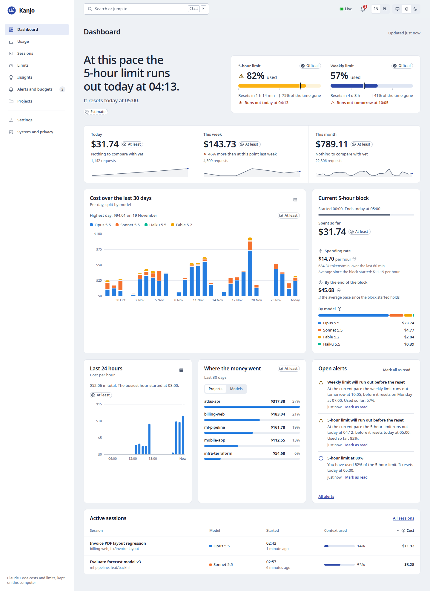
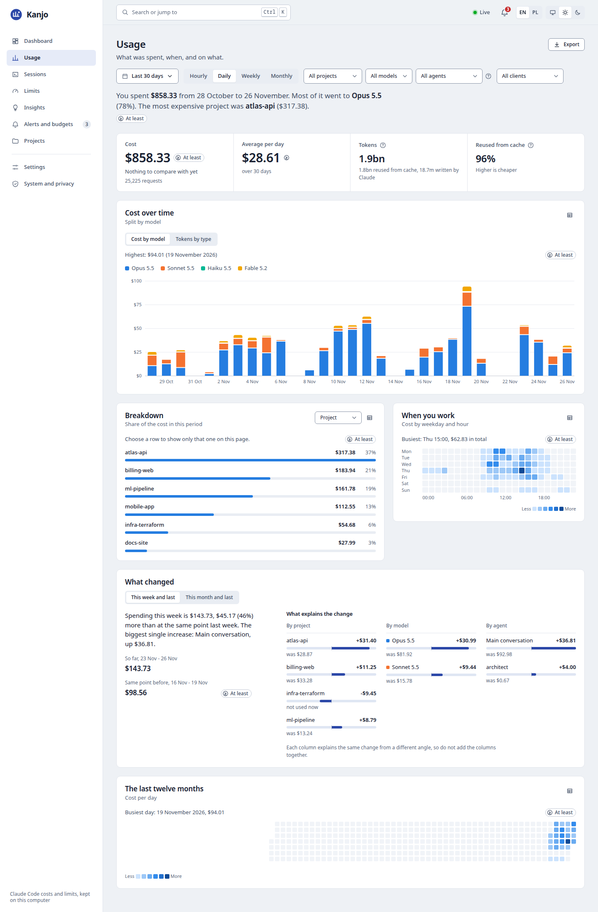
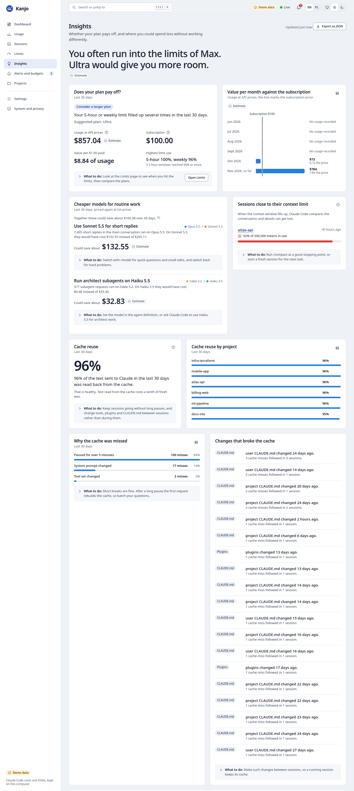

[English](README.md)

<h1 align="center">Kanjo</h1>

<p align="center"><b>Wiedz, kiedy Claude Code dojdzie do limitu i co go przepaliło.</b></p>

<p align="center">Monitor kosztów i limitów Claude Code, który działa offline. Prognozuje limit 5-godzinny i tygodniowy i pokazuje, ile kosztowała praca w podziale na projekty, modele, subagentów, skille, serwery MCP i narzędzia. Jeden program w Rust z wbudowanym dashboardem, a nic, co zbiera, nie opuszcza Twojego komputera.</p>

<p align="center">
  <a href="LICENSE"></a>
  <a href="https://github.com/Kyotu-Technology/kanjo/actions/workflows/ci.yml"></a>
  <a href="https://github.com/Kyotu-Technology/kanjo/releases/latest"></a>
  
  <a href="scripts/egress-test.sh"></a>
  
  
</p>

<p align="center"><a href="#instalacja">Instalacja</a> · <a href="#na-jakie-pytania-odpowiada-kanjo">Na co odpowiada</a> · <a href="#prywatność-i-bezpieczeństwo">Prywatność</a> · <a href="#dokumentacja">Dokumentacja</a> · <a href="#stworzone-przez-kyotu-technology">Kyotu Technology</a></p>

<picture>
  <source media="(prefers-color-scheme: dark)" srcset="docs/screenshots/dashboard-dark.png">
  
</picture>
<p align="center"><sub>Wszystkie liczby na zrzutach ekranu to syntetyczne dane demo z <code>kanjo demo</code>. Zrzuty pokazują wersję angielską.</sub></p>

| ~18 MB | 0 | 479 | 14 | 5 | 24 |
| :---: | :---: | :---: | :---: | :---: | :---: |
| jeden plik: kolektor, API i dashboard | połączeń wychodzących, czego pilnuje w CI test zerowego ruchu wychodzącego | testów Rusta i interfejsu webowego przy każdym pull requeście i pushu do main | zadań CI na Ubuntu, macOS i Windows | targetów wydań, każdy podpisany i wydany z SBOM i provenance | wycenionych modeli; ceny nieznanego nikt nie zgaduje |

## Instalacja

**macOS i Linux**

```sh
curl -fsSL https://github.com/Kyotu-Technology/kanjo/releases/latest/download/install.sh | sh
```

**Windows (PowerShell)**

```powershell
irm https://github.com/Kyotu-Technology/kanjo/releases/latest/download/install.ps1 | iex
```

**Homebrew (macOS i Linux)**

```sh
brew install kyotu-technology/tap/kanjo
```

Skrypty sprawdzają archiwum z plikiem `SHA256SUMS` wydania, a gdy zainstalowany jest cosign, także jego podpis Sigstore, i nie potrzebują sudo ani uprawnień administratora. Formuła Homebrew instaluje to samo archiwum, przypięte do jego sumy SHA-256. Potem:

```sh
kanjo demo    # 30 dni syntetycznych danych w katalogu tymczasowym, bez konta, nigdy nie czyta ~/.claude
kanjo up      # podłącza Claude Code: statusline, hooki sesji, usługa w tle, dashboard
```

`kanjo up` wypisuje, co zmieni w pliku `settings.json` Claude Code, zostawia kopię tego pliku i pyta o zgodę, zanim cokolwiek zmieni; `kanjo uninstall` wszystko to cofa. Opcje, weryfikację pobranego pliku i pełny przewodnik opisuje [docs/install.md](docs/install.md). Strony dokumentacji w katalogu `docs/` są po angielsku.

## Na jakie pytania odpowiada Kanjo

Nazwa pochodzi od japońskiego 勘定 (kanjō), czyli rachunku: tego, o który prosi się na koniec posiłku. Dashboard jest zbudowany wokół pytań, które zadaje programista na planie Pro, Max, Ultra lub Team albo rozliczany za API, i tych, które zadaje osoba, która za to płaci. Działa po angielsku i po polsku, w jasnym i ciemnym motywie, także na telefonie.

**Kiedy skończy mi się limit?** Claude Code przekazuje do statusline oficjalne procenty limitu 5-godzinnego i 7-dniowego (zweryfikowane konto Ultra ma tylko limit tygodniowy), a Kanjo zapisuje każdy odczyt. Na podstawie bieżącego tempa prognozuje, kiedy każdy z limitów się wyczerpie, pokazuje, kiedy się odnowi, i wylicza dzienny budżet do resetu tygodniowego. Dzięki temu zwalniasz już we wtorek, zamiast przekonać się o problemie w czwartek.

**Ile to kosztowało i na co poszło?** Każde zapytanie jest wyceniane po cenniku API: koszt dzisiaj, w tym tygodniu i w tym miesiącu, w podziale na projekty, modele, subagentów, skille, serwery MCP, narzędzia, gałęzie gita, źródła zapytań i klientów. Porównanie okresów wyjaśnia, co urosło od zeszłego tygodnia albo miesiąca.

**Czy mamy dobry plan?** Kanjo porównuje wartość Twojego użycia po cenach API z ceną subskrypcji i radzi zostać przy obecnym planie, przejść poziom wyżej lub niżej (Pro, Max i Ultra albo stanowiska Standard i Premium w planie Team) albo przejść na rozliczenie za API.

**Gdzie przepalamy pieniądze?** Strona Wskazówki pokazuje, ile wraca z cache promptów i dlaczego cache się zepsuł, podpowiada tańszy dobór modeli z szacowaną oszczędnością i wymienia sesje bliskie limitu kontekstu.

**Czy ktoś mnie uprzedzi, zanim to się stanie?** Alerty odpalają się po przekroczeniu progów limitu, gdy prognoza mówi, że limit skończy się przed resetem, przy budżetach na projekt, klienta, dzień, tydzień lub miesiąc oraz przy skokach kosztów, sesjach, które wymknęły się spod kontroli, i pętlach agentów. Widać je na dashboardzie i jako powiadomienia systemowe; nic nie idzie e-mailem ani na komunikator.

<p align="center">
  
  
  
</p>
<p align="center"><sub>Limity, Zużycie i Wskazówki na danych demo.</sub></p>

**W samym Claude Code** `kanjo up` instaluje statusline, na przykład `Opus | $1.23 | 5h 42% 59m | 7d 63% 2d23h`. Jeśli masz już własny, Kanjo staje przed nim w trybie łańcucha (chain mode), a Twój statusline nadal jest widoczny.

**Wyciąganie liczb**: `kanjo daily`, `weekly`, `monthly`, `session` i `blocks` drukują tabele, z `--csv` CSV, a z `--json` JSON w kształcie ccusage; `kanjo export` zapisuje siedem widoków do CSV lub JSON, a te same dane udostępnia lokalne [API JSON](docs/api.md).

Każda liczba ma etykietę. **Oficjalne** pochodzą od samego Claude Code, **Szacunek** wylicza Kanjo, a **Co najmniej** to suma z transkryptów po cenniku API, w której może zabraknąć jakiegoś zapytania, więc prawdziwy koszt jest co najmniej taki, jak pokazany. Model, którego nie ma w cenniku, jest liczony jako niewyceniony, nigdy jako darmowy. Więcej w [docs/features.md](docs/features.md).

## Prywatność i bezpieczeństwo

Kanjo czyta pliki, które Claude Code zapisuje na Twoim komputerze. Nie potrzebuje konta, nie łączy się z Anthropic i nie czyta Twoich danych logowania do Claude. Parser zachowuje wyłącznie liczby dotyczące użycia i metadane: treść promptów i odpowiedzi nigdy nie jest zapisywana, logowana ani eksportowana.

Nie ma żadnych połączeń wychodzących: ani telemetrii, ani sprawdzania aktualizacji, ani pobierania cennika. cargo-deny nie wpuszcza bibliotek klientów HTTP do drzewa 282 zależności, a zadanie CI uruchamia program w przestrzeni nazw sieci z samym loopbackiem, potem jeszcze raz pod `strace`, i kończy się błędem przy każdym połączeniu innym niż loopback, lokalne gniazdo albo DNS.

Baza jest szyfrowana przez SQLCipher, a jej klucz trzyma systemowy pęk kluczy. Dashboard nasłuchuje na `127.0.0.1` za tokenem dostępu, a eksporty, zmiany ustawień i usunięcia trafiają do dziennika audytu spiętego łańcuchem skrótów.

Workflow wydań podpisuje `SHA256SUMS` przez cosign w trybie keyless i do każdego z pięciu targetów dołącza atestację pochodzenia buildu (provenance) oraz SBOM w formacie CycloneDX.

Szczegóły są w [docs/privacy.md](docs/privacy.md), [modelu zagrożeń](docs/security/threat-model.md), [inwentarzu danych](docs/security/data-inventory.md) i [SECURITY.md](SECURITY.md). [docs/security/iso27001.md](docs/security/iso27001.md) mapuje funkcje Kanjo na zabezpieczenia z załącznika A normy ISO/IEC 27001:2022, żeby wesprzeć własny ISMS organizacji; nie jest to certyfikacja i dokument niczego nie deklaruje w imieniu organizacji w sprawie zgodności.

## Dokumentacja

| Strona | Co opisuje |
| --- | --- |
| [Instalacja i pierwsze uruchomienie](docs/install.md) | Sposoby instalacji, budowanie ze źródeł, co zmienia `kanjo up`, `kanjo uninstall` |
| [Na co odpowiada Kanjo](docs/features.md) | Każda strona dashboardu w szczegółach, na ile można ufać każdej liczbie, jak to działa |
| [Prywatność i bezpieczeństwo](docs/privacy.md) | Co jest zapisywane, szyfrowanie, token dostępu, dziennik audytu, retencja |
| [Polecenia](docs/cli.md) i [konfiguracja](docs/configuration.md) | Każde polecenie, `config.toml`, katalogi danych, ceny i waluta |
| [API HTTP](docs/api.md) i [architektura](docs/architecture.md) | Lokalne API JSON i budowa ośmiu crate'ów |
| [Stan](docs/status.md), [stan funkcji](docs/feature-status.md) i [wydania](docs/release.md) | Co i gdzie przetestowano, znane ograniczenia, weryfikacja pobranego pliku |

## Stan projektu

Kanjo działa dla jednej osoby na jednym komputerze. CI testuje je na Ubuntu 24.04, macOS 15 i Windows Server 2025, jednolinijkową instalację na Linuksie uruchomiono na opublikowanym wydaniu, a całą ścieżkę od instalacji do odinstalowania przeszło na Windows 11 w maszynie wirtualnej, z instalatorem w wersji sprzed przeróbki pod uruchamianie przez potok. Opublikowanego wydania nie zainstalowano ręcznie na macOS ani na Windows, a `kanjo up` i usługi w tle nie uruchamiano ręcznie na Macu. Historia sięga tylko tak daleko, jak transkrypty, które są jeszcze na dysku, więc warto zainstalować Kanjo wcześnie. Sprawdzone platformy i znane ograniczenia opisuje [docs/status.md](docs/status.md).

## Stworzone przez Kyotu Technology

Kanjo rozwija i utrzymuje [Kyotu Technology](https://www.kyotutechnology.com/), firma programistyczna, która buduje oprogramowanie na zamówienie, systemy webowe, aplikacje mobilne i rozwiązania cloud/DevSecOps dla klientów z branży medycznej, fintechu i energetyki, z siedzibą w Warszawie i biurami we Wrocławiu, Austin i Nowym Jorku. Kyotu Technology używa Claude Code we własnej pracy dla klientów: przeczytaj o [zespołach agentów Claude Code na produkcji](https://kyotutechnology.com/claude-code-agent-teams-in-production-api-migration/) i o tym, [jak Kyotu Technology przebudowało swoją stronę z Claude Code](https://kyotutechnology.com/how-we-rebuilt-our-website-with-claude-code/).

Kyotu Technology ma [certyfikat ISO/IEC 27001:2022](https://www.kyotutechnology.com/iso-27001-2022-certification-kyotu-technology/) wydany przez DEKRA Certification (nr 00082600610, ważny do 17 sierpnia 2029), a zakres certyfikacji obejmuje rozwiązania AI/ML/LLM i DevOps. Certyfikat należy do firmy: samo Kanjo nie jest certyfikowane i zamiast tego zawiera [mapowanie swoich funkcji na zabezpieczenia z załącznika A](docs/security/iso27001.md).

Wdrażasz agentów AI do programowania i chcesz, żeby koszty, kontrola i bezpieczeństwo trzymały się w ryzach? [Porozmawiaj z Kyotu Technology](https://www.kyotutechnology.com/contact/).

## Podziękowania

Kanjo korzysta z pomysłów narzędzi, które powstały przed nim. ccusage ukształtowało raporty okresowe i ich format `--json`, lokalny dashboard cctally, jego prognozy limitów i koszt jednego procenta limitu tygodniowego ukształtowały stronę Limity, Claude-Code-Usage-Monitor etykiety wiarygodności i szacunki limitów na podstawie historii, a ccstatusline statusline i jego tryb łańcucha. Ceny pochodzą z danych o cenach modeli publikowanych przez projekt LiteLLM.

## Współpraca, bezpieczeństwo i licencja

Wkład jest mile widziany: [CONTRIBUTING.md](CONTRIBUTING.md) wyjaśnia, jak budować i testować, oraz jakich zasad przestrzega każda zmiana. Podatności zgłaszaj prywatnie, jak opisuje [SECURITY.md](SECURITY.md), a nie w publicznym zgłoszeniu. Zmiany są opisane w [CHANGELOG.md](CHANGELOG.md).

Prawa autorskie do Kanjo należą do Kyotu Technology, a program jest udostępniony na [licencji Apache 2.0](LICENSE). Plik wykonywalny zawiera SQLCipher i OpenSSL; ich informacje licencyjne są w pliku [NOTICE](NOTICE).

„Claude” i „Claude Code” są znakami towarowymi Anthropic. Kanjo to niezależny projekt open source firmy Kyotu Technology. Nie jest powiązane z Anthropic ani przez Anthropic popierane czy sponsorowane, a nazw tych używa wyłącznie po to, by powiedzieć, z czym współpracuje.
