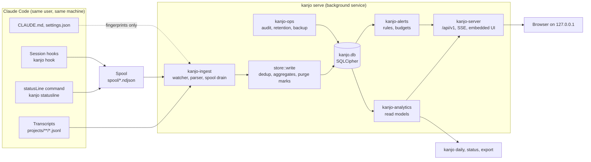

# Architecture

Kanjo is one Rust binary, `kanjo`, that contains the collector, a local HTTP API, the web dashboard and the command line. It runs as the user who runs Claude Code, reads the files Claude Code writes on the same machine, keeps what it learns in an encrypted SQLite database in its own data directory, and serves the dashboard on the loopback interface. It makes no outbound network connections. This document explains how the pieces fit together and why the boundaries are where they are.

Kanjo is an independent open-source project published by Kyotu, not a product of Anthropic. "Claude" and "Claude Code" are Anthropic's names for its products.

## Crate map

The workspace is split by responsibility. Each crate depends only on the crates listed for it, and the arrows never point upwards.

| Crate | Depends on | Job |
| --- | --- | --- |
| `kanjo-core` | (none) | Domain types, `Paths`, the start-up `Config`, the `Store` (SQLCipher), the schema and its migrations, the request write path, the price table, limit samples and forecasts, the statusline payload, the spool, UI settings, and the API contract in `api.rs`. No HTTP, no file watching, no operating-system integration. |
| `kanjo-ingest` | core | Transcript discovery and parsing, backfill, the file watcher, the spool drain, configuration fingerprints, and the transcript viewer's reader. |
| `kanjo-analytics` | core | Every read model behind the dashboard and the reports, and CSV and JSON export shaping, including path redaction. Its only write is the project's display name and client (`update_project`). |
| `kanjo-alerts` | core | Alert rules, budgets, anomaly and cache insights, and local notification delivery. |
| `kanjo-ops` | core | Database key management, the audit log, retention and purge, backup and restore, signed price import, the access token and demo data. |
| `kanjo-setup` | core | Claude Code integration (`statusLine` and hooks in `settings.json`), the background service, `kanjo doctor`, statusline rendering and the record of a running server (`server_file`). |
| `kanjo-server` | all of the above | The axum router and its security layers, server-sent events, the embedded web UI, and the runtime that drives the ingest, alert and retention loops. |
| `kanjo` (`crates/kanjo-cli`) | all | The `kanjo` binary: a thin clap front end. The server is behind the default `server` feature. |
| `web/` | the generated bindings | The Svelte and Vite single-page app, built into `web/dist` and embedded into `kanjo-server`. |

The reasons for these boundaries are practical. Keeping `kanjo-core` free of HTTP, watching and OS calls means the schema, the write path and the API types can be tested with nothing but a temporary directory, and every other crate shares one definition of them. The five feature crates depend on `kanjo-core` only, never on each other, so ingest cannot answer HTTP, analytics cannot reach the audit or key code, and the key, audit and deletion code in `kanjo-ops` has one owner. That only `kanjo_core::store::write` and retention change the usage tables is a project rule kept by review, not something the dependency graph enforces: every crate that can open a `Store` could write to it. Everything that touches the user's machine outside the data directory (Claude Code's `settings.json`, the service manager) is in `kanjo-setup`, which makes it easy to review what Kanjo changes there. `kanjo-server` is the only crate that listens on the network, so all of the request guards live in one file (`crates/kanjo-server/src/security.rs`). The CLI is thin so that the dashboard, `--json` output and scripts all see the same numbers from the same read models.

## Data flow

**Transcripts.** Claude Code writes one JSON Lines file per session under `<Claude directory>/projects/<project key>/`, and subagent transcripts beside it. `kanjo-ingest` imports the existing history when the server first starts (`Ingestor::backfill`, with progress on the event stream), then follows new lines with a recursive `notify` watcher, debounced, with a periodic safety scan for missed events; if no watcher can be started it scans every 30 seconds. A byte cursor per file in `ingest_files` means each line is read once; a file that shrank is read again from the start, which is harmless because writes deduplicate. The parser (`crates/kanjo-ingest/src/record.rs`) finds the record type on the raw bytes without decoding strings, decodes only the usage and metadata fields of the record types it handles, and records anything it does not understand in `quarantine` by type and top-level key names. Prompt and response text is never copied.

**Statusline and hooks.** Claude Code runs `kanjo statusline` on every status update and `kanjo hook` on SessionStart, Stop and SessionEnd, piping JSON to them. These commands must be fast and must never fail Claude Code, so they never open the database: `main.rs` recognises them before parsing arguments, and `crates/kanjo-cli/src/fast.rs` reduces the payload to the fields Kanjo keeps, appends one line to the day's spool file, prints the statusline (or runs a chained one) and exits 0. The server drains the spool every two seconds into `session_status`, `limit_samples`, `cache_misses` and `session_events`. The statusline is the only source of the official five-hour and seven-day limit percentages.

**Configuration fingerprints.** Once a minute the server hashes the user's `CLAUDE.md`, `settings.json`, its enabled plugins and the `CLAUDE.md` of recently active projects, and writes a `config_changes` row when one changes. Insights correlate these with prompt cache misses. Only the hash is kept.

**Alerts and retention.** The alert loop evaluates the rules once a minute and shortly after new usage arrives, stores each alert once per rule and window, and delivers it as a desktop notification and on the event stream. Retention runs once a day. Both run only inside a server; demo mode starts none of the background loops.

**Reading.** Every view of the dashboard and every report is a function in `kanjo-analytics` that takes a `Store`, a `Ctx` (the current time, the time zone and the first day of the week, so tests never read the clock) and a `Query`, and returns a type from `kanjo_core::api`. The server's handlers call these on the blocking thread pool and return them as JSON; the CLI calls the same functions directly, without HTTP. The server also pushes `LiveEvent`s (new usage, limits, alerts, import progress, statusline changes) over server-sent events at `/api/v1/events`, and the UI refetches what it shows when one arrives.

## The write path

Rows enter `requests`, `sessions` and `usage_hourly` only through `kanjo_core::store::write` (`crates/kanjo-core/src/store/write.rs`). The only other code that changes those tables is deletion in `kanjo_ops::retention`. All other tables are written by the crate that owns the feature, inside `Store::write`. The invariants this protects are these.

A response is identified by its message id. Claude Code writes one response as several records (one per content block, and a streaming record that is later completed), so `insert_request` inserts a new message once, adds tool uses it has not recorded before (keyed by request, tool block id and kind), and when a repeat carries more tokens than before, updates the row and moves the session totals and the hourly aggregate by the difference. Reading a file twice, rescanning everything or importing the same transcript from a copy therefore never counts anything twice.

The session totals and the hourly aggregate always equal the sum of the request rows they were built from, except where retention has removed old request rows on purpose: the aggregates outlive them. Repricing after a price import moves the totals by the difference for the rows that still exist, so history that retention already removed stays priced as it was. A model missing from the price table is stored with no cost and counted as unpriced, never as free.

Deletion sticks. A purge or a retention pass leaves a purge mark (scope, target, time), and `insert_request` refuses a new message that falls inside one; the spool drain applies the same check. A rescan, a rewritten transcript or a restart cannot bring deleted history back, and requests that retention removed after counting them into the aggregates are not counted again.

All writes go through one writer connection in an `IMMEDIATE` transaction, so a second Kanjo process (a command line import while the service runs) waits for the busy timeout instead of failing. Reads use a small pool of query-only connections. The database runs in WAL mode with `secure_delete` on. Each write batch checks whether another process imported a new price table and reloads it. Blocking database work never runs on the async runtime's threads.

Timestamps are epoch milliseconds in UTC everywhere in the store. Local days, weeks and months are computed at read time through `Ctx`, which follows the system time zone and uses the offset in force at each moment, so a range across a daylight saving change stays on local midnight and a clock-change day is 23 or 25 hours long. Hourly totals in `usage_hourly` are kept per UTC hour, so in a zone with a fractional offset (such as UTC+5:30 or UTC+5:45) a day or bucket edge built from them is approximate to the hour; views that read request rows, such as cost-spike detection, stay exact.

## The API contract and generated bindings

Every JSON shape exchanged between the engine, the HTTP API, the CLI's `--json` output and the web UI is defined once, in `crates/kanjo-core/src/api.rs` and `settings.rs`. The types derive `ts_rs::TS`, and `scripts/gen-bindings.sh` runs `cargo test -p kanjo-core export_bindings` to write the TypeScript definitions into `web/src/lib/api/bindings` and a barrel file `web/src/lib/api/contract.ts`, from which the UI imports every API type. Changing a shape therefore means changing `api.rs`, regenerating the bindings and updating the UI in the same change; a mismatch fails the UI's type check. The endpoints, sign-in, limits, error codes and the audit vocabulary are documented in [api.md](api.md).

## One binary with the UI inside

`crates/kanjo-server/build.rs` copies the built UI from `web/dist` (or the directory in `KANJO_WEB_DIST`) into the build's `OUT_DIR` and generates a table of `include_bytes!` entries, so the files are compiled into the binary in every profile. When the UI has not been built it embeds a one-page placeholder, so `cargo build` works without Node. At run time `assets.rs` serves the files from that table, with `index.html` as the fallback for client-side routes, long-lived caching for hashed assets under `assets/` and `no-store` for `index.html`. The Content-Security-Policy is computed once from the embedded `index.html`: scripts are allowed from the server itself and by the SHA-256 of each inline script in that file, styles only from the server. A browser therefore needs nothing but the binary: no CDN, no web server and no separate install of the UI.

## Extension points

### Embedding the server

`kanjo-server` exposes the server as a library, so another process can host the same server and UI without a second implementation. `kanjo_server::start(ServeOptions)` validates the configuration, binds, opens the store, starts the background loops and writes the server record, and returns a `Server` with `local_addr()` (useful with port 0), `url()`, `login_url()` (a single-use sign-in URL), `stopped()` and `shutdown()`. `kanjo_server::serve` does the same until a future resolves, and `kanjo_server::run` and `run_with` own their runtime for a blocking process. `kanjo_server::router(AppState)` returns the axum router with all its security layers, and `AppState::open` builds the state without starting any loop, for a host that wants to wrap the router in its own layers. A host that serves that router with its own listener does without what the accept loop in `net.rs` adds: the peer and local addresses the guards use, the connection limit and the header and TLS handshake timeouts. `start` refuses to run while another live server holds the server record (`server.json`) in the same data directory.
