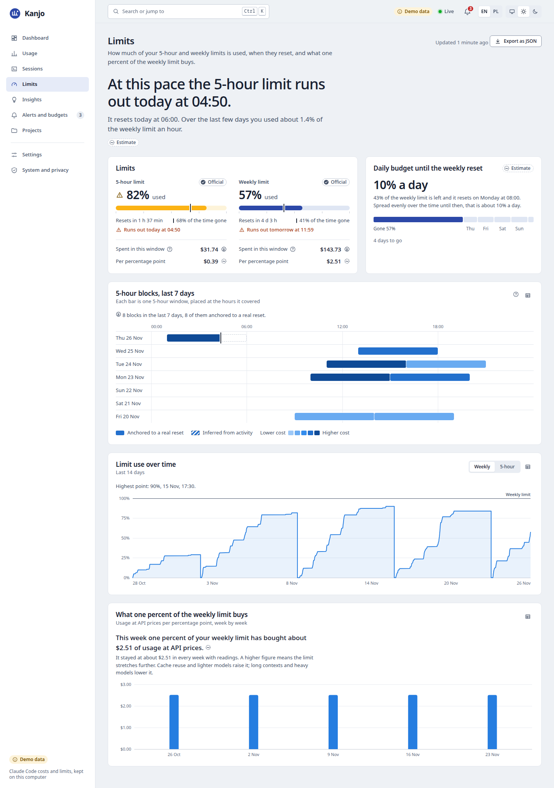
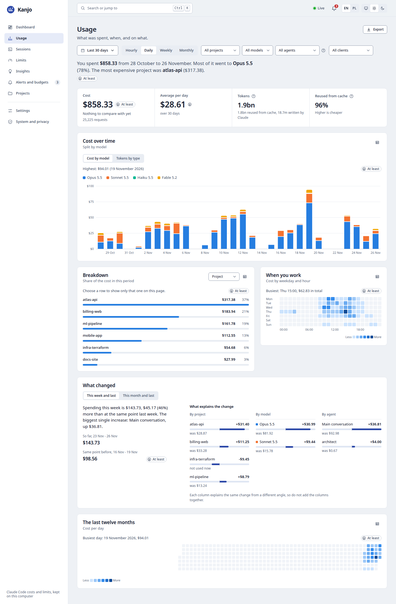
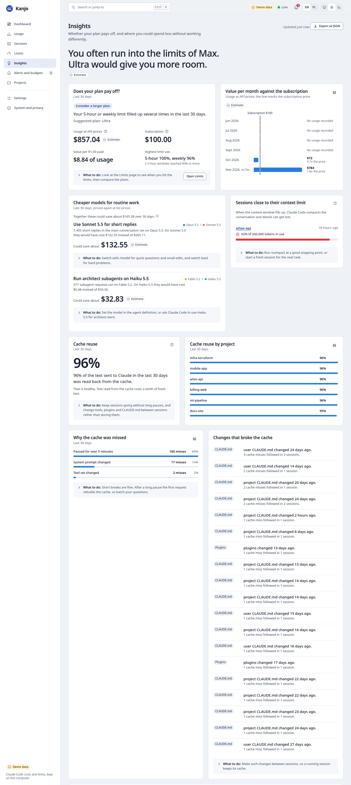
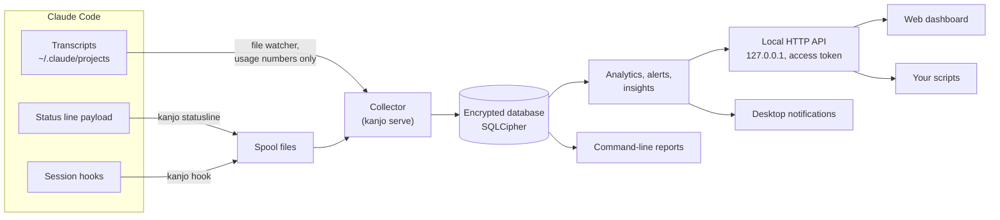

# What Kanjo answers

This page describes what the dashboard and the command line show, how far each figure can be trusted, and where the data comes from. The [README](../README.md) has the short version; installing and connecting Claude Code is described in [install.md](install.md).

Kanjo is an independent open-source project published by Kyotu Technology, not a product of Anthropic. "Claude" and "Claude Code" are Anthropic's names for its products.

A developer on a Pro, Max or Ultra subscription, on a Team seat, or on API billing directly or through a gateway, wants to know whether today's work will run into a limit. Someone in finance or operations wants to know what Claude Code costs and whether the plan is the right one. The dashboard is organised around those questions. It is available in English and Polish, with light and dark themes and a mobile layout.

## When will I hit my limit?

Claude Code reports the official 5-hour and 7-day usage percentages to its status line, and Kanjo records each reading. From the pace of the last few hours it forecasts when each limit runs out ("at this pace the 5-hour limit runs out today at 16:10"), shows when each one resets, and works out a daily budget until the weekly reset, so you can see whether to slow down on Tuesday rather than discover it on Thursday. It also tracks what one percent of the weekly limit buys at API prices, week by week, which shows whether the limit stretches further or less far as your way of working changes. 5-hour blocks are drawn on a timeline anchored to the real reset times.


*The Limits page.*

## What did this cost, and where did it go?

Every request in Claude Code's transcripts is priced at API list prices, so you see cost today, this week and this month, a spending rate per hour and a projection for the current 5-hour block. The Usage page breaks the cost down by project, model, subagent, skill, MCP server and tool, as well as by git branch, by request source (the part of Claude Code that sent the request, such as the main conversation or a compaction) and by client once you assign projects to clients. A period comparison explains what grew: this week against the same point last week, or this month against last month, by project, model and agent. Heatmaps show cost by weekday and hour and over the last twelve months. Days, weeks and months follow the system time zone, including the days on which daylight saving time starts or ends. Input, output, cache reads and both cache-write lifetimes are kept separately.


*The Usage page.*

## Is our plan the right one?

Kanjo compares the API-equivalent value of your usage with the price of your subscription (you choose the plan and can enter what you actually pay). It then suggests keeping the plan, moving up a tier because you keep reaching the limits, moving down because the limits are rarely used, or switching to API billing because the work would cost less there. The tiers are Pro, Max and Ultra for an individual subscription and the Standard and Premium seats of the Team plan. Kanjo starts from the plan's monthly list price, per seat for Team; Enterprise and custom plans have no list price in Kanjo, so enter what you pay.

## Where are we wasting money?

The Insights page shows how much of what is sent to the model comes back from the prompt cache, per project and session, and when the cache broke, why: Claude Code's reported cause of the miss, and changes to CLAUDE.md, settings, plugins or the set of tools that line up with it. It suggests a cheaper model mix where one fits, for example a smaller model for short replies or for a particular subagent, with an estimated saving. It lists sessions that are close to their context limit, and the alert engine flags cost spikes, runaway sessions and agent loops.


*The Insights page.*

## Will someone tell me before it happens?

Alerts fire at limit thresholds (80, 90 and 95 percent by default, once per window), when the forecast says a limit will run out before it resets, when a budget is close or exceeded, on cost anomalies, a cold cache and long contexts. Budgets can be set for all usage, a project or a client, per day, week or month. Alerts appear in the dashboard and as desktop notifications, and can ring the terminal bell when the server runs in a terminal (`kanjo serve`; under the background service there is no terminal, and Settings says so). Nothing is sent by e-mail or to a chat service.

## And inside Claude Code itself?

`kanjo up` installs a status line that shows the model, the session cost, both limits and the time to their reset, and the cache state when Claude Code reports it, for example:

```
Opus | $1.23 | 5h 42% 59m | 7d 63% 2d23h
```

If you already use a status line of your own, Kanjo goes in front of it in chain mode: it records the payload, then runs your command with the same input and shows its output, so your status line keeps working.

## Can I get the numbers out?

The command line prints the same reports as the dashboard (`kanjo daily`, `weekly`, `monthly`, `session`, `blocks`, `status`) as tables or, with `--json`, as JSON; all of them except `status` also print CSV with `--csv`. The JSON of the period reports follows the shapes of ccusage's `--json` output (modelled on its documentation, not yet tested against ccusage itself). `kanjo export` writes the usage, breakdown, sessions, blocks, turns, alerts and audit views to CSV or JSON, and the same views are available from the local JSON API under `/api/v1`, described in [docs/api.md](api.md).

## How far each number can be trusted

Every figure in Kanjo carries one of three labels, in the dashboard and in the command line.

**Official** figures come from Claude Code itself: the 5-hour and weekly limit percentages, their reset times and the session cost that Claude Code reports to its status line. Kanjo stores them as they arrive.

**Estimates** are worked out by Kanjo: forecasts, the daily budget, plan advice, savings from a different model mix, and limit percentages calibrated from history when no status line reading exists.

**Lower bounds** (shown as "At least") are costs summed from the transcripts at API list prices. The transcripts are the only record of individual requests, but they can miss some (retries or interrupted responses, for example), so the real figure is at least the one shown. A model that is missing from the price table is never counted as free and never given a guessed price: its requests are counted as unpriced and the dashboard says so.

Two more things are worth knowing. API list prices are what the work would cost on pay-as-you-go billing; on a subscription you pay the plan price, which is why Kanjo shows both. And the limit percentages only exist when Claude Code sends them to the status line, which its documentation says it does for Pro, Max and Ultra subscriptions and behind a Claude apps gateway that sets a spend limit, after the first response of a session and while a session runs. A verified Ultra account has no 5-hour limit, only the weekly one, so on Ultra Kanjo shows the weekly limit alone, makes no 5-hour estimate and judges the plan by the weekly peak. On Max, Ultra and Team Premium seats, Fable models may use at most half of the weekly limit; the status line has no separate reading for that cap, so Kanjo does not show it. Without the status line installed, Kanjo can only estimate the 5-hour use from past blocks.

## How it works

Kanjo has three sources, all on the local machine. The **transcripts** that Claude Code writes under `~/.claude/projects` hold one record per request with its model and token counts; Kanjo imports the history once and then watches the files, reading only what was appended. The **status line payload** that Claude Code passes to `kanjo statusline` on every update carries the official limit percentages, the session cost, context usage and cache information. The **session hooks** mark when sessions start and end. Claude Code runs the status line and hook commands itself, so they are kept fast: they open no database, only append the payload to a spool file in the data directory (the status line also prints its text), and the collector moves it into the database.



The code is a Rust workspace of eight crates with one job each: `kanjo-core` (types, storage, prices), `kanjo-ingest` (transcript parsing and watching), `kanjo-analytics` (every report), `kanjo-alerts` (alerts, budgets and insights), `kanjo-ops` (keys, audit, retention, backups, price import), `kanjo-setup` (Claude Code integration, the service, `kanjo doctor`), `kanjo-server` (HTTP API and the embedded UI) and `kanjo-cli` (the `kanjo` binary). The dashboard is a Svelte application in `web/`, built before the binary and embedded in it, so it loads nothing from the internet. [docs/architecture.md](architecture.md) explains the design and [docs/api.md](api.md) the HTTP API.
